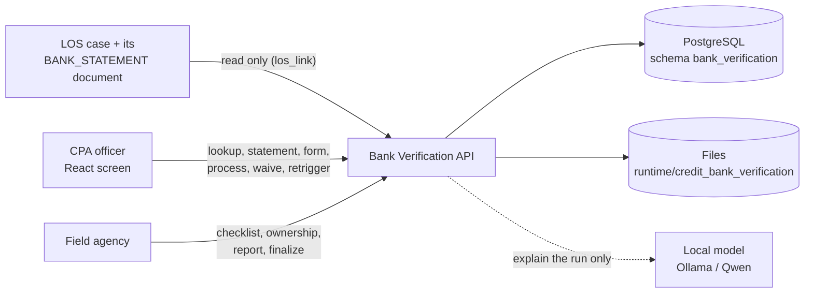

# Bank Verification — Design

The bank verification step of a loan application. The CPA (credit processing) officer finds one case by its case ID or
application number, enters (or checks) the applicant's bank details and latest transactions, uploads the bank
statement or uses the Account Aggregator (AA) data, and runs eight deterministic rules; the field agency then
finalizes with its branch checks and report. **No model decides anything**: the rules and the finalize rules set the
status, and the local language model (Qwen via Ollama) only explains the run's results in plain words.

| | |
|---|---|
| Backend code | `backend/agents/bank_verification/` |
| Frontend (React) | `frontend/src/agents/bank_verification/` |
| API base | `/api/v1/bank-verification` (router prefix `/bank-verification`, mounted under `/api/v1` by `backend/main.py` through `agents/registry.py`) |
| Database | PostgreSQL `agentic_LOS`, schema `bank_verification` (one schema per agent; `shared/config/agent_databases.yaml`) |
| Rules in force | rule set `bank_verification_policy` in the database; `conf/bank_verification.yaml` is the source of a version |

---

## 1. Context



* **Authentication**: every route sits behind the LOS JWT (`main.py` mounts each agent router with
  `Depends(require_jwt)`). `security.py` turns the token's scopes into a role (`security.role_by_scope`, first match):
  `los.bank.agency` → AGENCY, `los.credit.underwrite` / `los.write` → CPA, `los.read` → VIEWER. An AGENCY caller's
  agency comes from the token claim `agency_id` (`security.agency_claim`), never from the request; it may finalize only
  for itself (403 `NOT_YOUR_AGENCY`).
* **Demo mode**: the role is simulated (`X-Demo-Role`, `X-Demo-User`), default one `DEMO_USER` who may do every step.
* **Claim vs evidence**: the bank and account number on the form come from the application (the claim); the statement
  or AA data is the evidence. Account numbers are masked in every answer, report and log.

## 2. Layout

```
agents/bank_verification/
├── api.py                  HTTP only: body parsing (JSON or multipart), permission check, routes -> services
├── security.py             Caller (role, user, agency) from the token, or the simulated demo role; require()
├── config.py               cfg() = the rule set in force (shared/db/rule_store); wording, demo, home(), demo_mode()
├── schemas.py              Pydantic models and enums (Mode, RuleStatus, Severity, FinalStatus, ...); mask()
├── normalize.py            folding of bank names, holder names, account numbers and types before comparing
├── repository.py           the store: PostgreSQL (DSN) or the SQLite demo file; cases, sources, documents, runs, ...
├── db_schema.py            MIGRATIONS (append-only) and the demo purge SQL
├── main.py                 standalone app (port 8041) with the shared error envelope; serves a built frontend
├── services/
│   ├── verification_service.py  API 1: read the statement, build the form, idempotency, run R1–R8, record the run
│   ├── statement_service.py     a PDF / CSV statement -> header, transactions, file facts (text layer, else OCR)
│   ├── transaction_service.py   the latest transactions of a source and the form prefill
│   ├── decision_service.py      API 2: mandatory evidence and the deterministic finalize rules
│   ├── report_check.py          reads the agency's report (text or OCR) and checks it against the case
│   ├── aa_actions.py            AA cases: waive (reason) and retrigger
│   ├── los_link.py              finds an LOS case by case / applicant ID and syncs it (and its statement) in
│   ├── summary_service.py       plain-words checklist + the model's explanation, checked before it is shown
│   └── report_service.py        the verification report (HTML; PDF via PyMuPDF)
├── rules/
│   ├── base.py             Evidence, wording / flag helpers, reference source, verdict()
│   ├── bank_details.py (R1) transaction_matching.py (R2) statement_integrity.py (R3) account_ownership.py (R4)
│   ├── balance_validation.py (R5) source_crosscheck.py (R6) duplicate_detection.py (R7) risk_assessment.py (R8)
│   └── __init__.py         run_all(): R1–R7 in order, then R8 over their results
├── conf/
│   ├── bank_verification.yaml           policy + deployment sections (storage, uploads, background, scans, server,
│   │                                    security, ai_summary, los_cases)
│   ├── bank_verification_wording.yaml   every sentence, rule name, flag severity, status label
│   └── bank_verification_demo.yaml      synthetic banks, people, transactions and scenarios
├── demo_data/              scenarios, synthetic statement PDFs / CSVs, agency report PDFs, seed / reset
├── docs/                   API contract, architecture, business rules, user guide, manager explanation
└── tests/                  rules, reading, report check, summary, API, scenarios, production guards, e2e QA
```

## 3. Case lifecycle

```mermaid
stateDiagram-v2
    [*] --> PENDING_VERIFICATION: seeded / opened from the LOS
    PENDING_VERIFICATION --> READING: long or scanned statement (202)
    READING --> READY_FOR_FINALIZATION: run done, R8 PASS
    READING --> REVIEW_REQUIRED: run done, R8 FAIL / REVIEW / N/A
    PENDING_VERIFICATION --> READY_FOR_FINALIZATION: process, R8 PASS
    PENDING_VERIFICATION --> REVIEW_REQUIRED: process, R8 not PASS
    REVIEW_REQUIRED --> READY_FOR_FINALIZATION: process again
    READY_FOR_FINALIZATION --> POSITIVE: finalize
    READY_FOR_FINALIZATION --> NEGATIVE: finalize
    REVIEW_REQUIRED --> POSITIVE: finalize (reviews resolved by checklist)
    REVIEW_REQUIRED --> NEGATIVE: finalize (recorded finding)
    PENDING_VERIFICATION --> WAIVED: waive (AA cases, reason; any open status)
    POSITIVE --> [*]
    NEGATIVE --> [*]
    WAIVED --> [*]
```



The mapping from R8 to the case status is `case_status.after_run` in the wording file; `case_status.final` lists the
final statuses (POSITIVE, NEGATIVE, WAIVED). Guards enforced by the API:

* A final case takes no further action (409 `CASE_FINALIZED`); a case being read refuses actions (409
  `STATEMENT_BEING_READ`). A case left in READING after a restart is healed back to its last status.
* `process` with the same `Idempotency-Key` and the same inputs answers the stored run; other inputs → 409
  `IDEMPOTENCY_KEY_REUSED`. The same inputs without a key replay the last run too.
* `waive` / `retrigger` only for a case with AA data (409 `AA_ONLY`); waive needs a reason (max `waive.reason_max`).
* `finalize` needs a processed case (409 `NOT_PROCESSED`), a known agency (422 `UNKNOWN_AGENCY`) and, for POSITIVE /
  NEGATIVE, every checklist item, a rationale of `finalize.min_rationale_chars` and the report (422).

## 4. The eight rules

Each rule returns **PASS**, **FAIL**, **REVIEW_REQUIRED** (evidence missing or uncertain — never a pass by default) or
**NOT_APPLICABLE**, with the comparisons it made, missing evidence, risk flags and a recommended action. Flag
severities come from `bank_verification_wording.yaml rules.<id>.flags`.

| # | Rule | Checks | Flags (severity) |
|---|---|---|---|
| R1 | Bank Details Matching | form bank name, account number, account type vs the mode's reference source | ACCOUNT_NUMBER_MISMATCH (HIGH), BANK_DETAILS_MISMATCH (MEDIUM) |
| R2 | Latest Three Transactions Matching | each form row is one of the latest `latest_transactions.count` rows (date, amount, side) | LATEST_TRANSACTION_MISMATCH (MEDIUM) |
| R3 | Statement Integrity and Tampering Detection | readable, editing tool in metadata, modified after creation, rows outside the period; FAIL only if not a statement | NOT_A_STATEMENT, EDITING_TOOL_IN_METADATA, MODIFIED_AFTER_CREATION, TRANSACTION_OUTSIDE_PERIOD (MEDIUM); INCOMPLETE_EXTRACTION, READ_FROM_SCAN (LOW) |
| R4 | Customer Account Ownership Verification | only the agency's branch confirmation decides; holder name is supporting only | OWNERSHIP_NOT_CONFIRMED (HIGH), HOLDER_NAME_DIFFERS (MEDIUM) |
| R5 | Transaction Continuity and Balance Validation | opening + credits − debits = closing, running balances, `balance.tolerance` | BALANCE_INCONSISTENT (HIGH) |
| R6 | AA vs. Uploaded Statement Cross-Verification | account fields and transactions of both sources; one source → NOT_APPLICABLE | SOURCE_MISMATCH (HIGH) |
| R7 | Duplicate Statement and Document Reuse Detection | same bytes (EXACT) or same account + transactions (SIMILAR) in another case → REVIEW_REQUIRED | EXACT_DUPLICATE_DOCUMENT (HIGH), SIMILAR_DOCUMENT (MEDIUM) |
| R8 | Automated Risk Assessment and Explainable Reporting | sums up R1–R7 | — |

**Reference source** (`reference_source`): AA received → AA data, then the statement; AA not received → the statement.
A form value the statement filled must be ticked "Checked" by the CPA, or it stays REVIEW (`statement_prefill`).

## 5. Recommendation and decision

**R8**: FAIL if any rule failed, else REVIEW_REQUIRED if any needs a person, else PASS (NOT_APPLICABLE rules are left
out; all N/A → NOT_APPLICABLE). The next action is the most urgent one asked by a rule, in the order of config
`actions`; a failed R4 always gives `ESCALATE_NEGATIVE_EVIDENCE`. The case's `risk_level` is the highest flag severity.
"x of y checks passed" is a count of rules, not a probability.

**Finalize** (`services/decision_service.py`, config `finalize`):

* **NEGATIVE** only with a recorded negative finding (ownership NOT_CONFIRMED or a checklist MISMATCH); else
  REVIEW_REQUIRED.
* **POSITIVE** only if ownership CONFIRMED, branch visit COMPLETED, every checklist item VERIFIED, no open FAIL in
  `blocking_fail_rules` (R1, R2, R3, R5, R6), every REVIEW rule resolved by its checklist items (`review_resolved_by`),
  a readable statement (`readable_statuses`), and the agency report check PASS (`agency_report.required_for_positive`).
  Anything short → REVIEW_REQUIRED with each reason.
* **REVIEW_REQUIRED** requested → an interim save; nothing is decided.

**Agency report check** (`services/report_check.py`, config `agency_report`): the report must be readable, name this
case, be dated within `max_age_days` (30), and its customer name, account number, bank, ownership and agency must agree
with the case. Disagreement → FAIL; required value not found → REVIEW_REQUIRED.

**AI summary** (`summary_service.py`, config `ai_summary`): written in the background after each run
(`precompute`); its text must use only the facts' figures, no banned words, no rule codes, at most `max_chars`.
Refused, slow or model down → the rules-written summary, `source: "rules"`.

## 6. Data model (schema `bank_verification`)

| Table | Holds |
|---|---|
| `cases` | one row per case: application ref, applicant, amount, product, stage, mode, status, risk level, agency, `is_demo` |
| `sources` | every original input as received (LOS entry, AA data, form, finalize payload) as JSONB |
| `documents` | stored statements / agency reports: role, kind, size, SHA-256, fingerprint, account read, stored path |
| `extractions` | each reading of a statement: status (COMPLETE / PARTIAL / UNREADABLE / INVALID), data, facts |
| `runs` | each verification run: idempotency key, input hash, full response, `rule_set_hash` |
| `rule_results` | the eight results of a run, one row each |
| `decisions` | each finalize attempt: final status, requested, payload, outcome, report document, who |
| `summaries` | the plain-words summary of a run and its source |
| `audit_events` | append-only case history (who, when, what) |
| `rule_sets`, `rule_set_active`, `rule_set_changes` | policy versions, the one in force, who changed it and why |
| `api_responses`, `agent_logs` | every POST / PUT response (masked); WARNING+ logs |

Migrations in `db_schema.py`: `bank-0001`, `common-logs-0001`, `bank-0002` (rule sets, `rule_set_hash`, append-only
audit), `rules-0001`, `responses-0001`. A change is always a new migration. `PURGE_DEMO_SQL` removes demo rows only.

Files are stored under `storage.home` (default `runtime/credit_bank_verification`; `BANK_VERIFICATION_HOME`
overrides). Uploads are checked by content: statements PDF / CSV, reports PDF / PNG / JPG, up to 50 MB.

## 7. API

| Method | Path (under `/api/v1/bank-verification`) | Permission | Purpose |
|---|---|---|---|
| POST | `/process` | process | API 1: read the statement, run R1–R8, record the run (202 while reading); `Idempotency-Key` |
| POST | `/cases/{id}/statement` | process | read an uploaded statement now; return what it fills on the form |
| POST | `/cases/{id}/report/check` | finalize | check an agency report against the case (nothing stored) |
| POST | `/cases/{id}/waive` | waive | AA cases: waive with a reason |
| POST | `/cases/{id}/retrigger` | retrigger | AA cases: run the eight checks again on the AA data |
| POST | `/{id}/finalize` | finalize | API 2: the agency's checklist, ownership, report, decision |
| GET | `/config` | any role | demo flag, agencies, checklist, actions, role, permissions, form suggestions |
| GET | `/summary` | any role | dashboard counts (`summary_cards`) |
| GET | `/lookup?ref=` | any role | exactly one case by case ID / application number (LOS cases synced first) |
| GET | `/cases?q=&source=&status=&risk=` | any role | cases, filtered |
| GET | `/cases/{id}` | any role | header, AA data (masked), latest run, prefill, documents, decisions, runs |
| GET | `/cases/{id}/summary` | any role | AI summary + the eight checks in plain words |
| GET | `/cases/{id}/history` | any role | timestamped case history |
| GET | `/cases/{id}/report?format=pdf\|html` | any role | the verification report |
| GET | `/cases/{id}/documents/{doc}` | any role | a stored statement / report file |
| POST | `/demo/reset` | demo only (403 `DEMO_ONLY`) | wipe and reseed the synthetic cases |

POST bodies are JSON, or multipart with a `request` JSON field plus the file (`statement` / `report`). Errors use
`{"error": {"code", "message", "details"}}`.

**Roles → permissions** (`conf roles`): CPA `view, process, assign_agency, waive, retrigger`; AGENCY `view, finalize`;
VIEWER `view`; DEMO_USER (demo only) all of them.

## 8. Frontend

`frontend/src/agents/bank_verification/` — React 18 + TypeScript, built with Vite; tests with Vitest + Testing Library.

* **App / SearchPage**: a search box in the top bar; the case ID or application number opens one case (`/lookup`).
  The screen never lists cases.
* **CaseDetailPage**: the case header and `Flow` (bank details → verification → agency → report), with:
  `BankAccountPanel` (the form, statement upload, run / waive / retrigger), `StatementViewer` (the statement beside
  the form), `ResultsTable` (each check, what was compared with what), `FailPopup` (the failed checks at once),
  `SummaryCard` (the summary as points), `AgencyPanel` + `ReportCheckView` (finalize and the report check),
  `ReportPanel` (case history and report download).
* API calls go through `src/services/api.ts` (same-origin `/api/v1/bank-verification`); types in `src/types/api.ts`.

Run: from `frontend/`, `npm install && npm run dev` → http://localhost:5190/bank_verification (the one console app;
this screen is one tab of the console). `BV_API` points this agent's API base route at another backend
(default `LOS_API`, `http://127.0.0.1:8010`). Build: `npm run build` → `frontend/dist/` (one chunk per agent).
Lists that can grow are paginated with the shared `Pagination` (`frontend/src/shared/components`).

## 9. Configuration and operations

* Settings: `backend/.env` — `LOS_AGENTIC_DSN` (or `BANK_VERIFICATION_DSN` for a database of its own), JWT settings,
  `ENVIRONMENT`. A DSN means PostgreSQL; without one the SQLite demo store is used, and only in demo mode.
* Agent variables: `BANK_VERIFICATION_HOME` (files), `BANK_VERIFICATION_BACKEND` (`postgres` / `sqlite`),
  `BANK_VERIFICATION_AI_SUMMARY`, `BANK_VERIFICATION_SCANS`, `BANK_VERIFICATION_LOS` (on / off overrides).
* Policy changes: edit `conf/bank_verification.yaml`, then `python scripts/rules.py import bank_verification_policy
  --by "<name>" --note "<why>" --activate` (from `backend/`). In force within `rules.cache_seconds`, no restart. The
  sections `storage, uploads, background, scans, server, security, ai_summary, los_cases` are always read from the file.
* Demo mode (`demo_mode: true`, `status: DEMO_DUMMY` today): simulated roles, synthetic scenarios, `/demo/reset`, the
  SQLite store. Must be off in production; limits and lists are starting values for the owner to confirm.
* Standalone: `python -m uvicorn bank_verification.main:app --port 8041` (per `main.py`); CORS allows port 5174.
* Database schema: created / upgraded by `scripts/setup_agent_databases.py`; `--purge-demo` removes demo rows.

## 10. Tests

`python -m pytest -q agents/bank_verification/tests` (from `backend/`) covers the rules, statement reading, the agency
report check, the summary, the API, the demo scenarios, production guards and an end-to-end QA pass. Frontend:
`npm test` (Vitest, `src/test/`) in `frontend/` (`npx vitest run --project bank_verification`).
