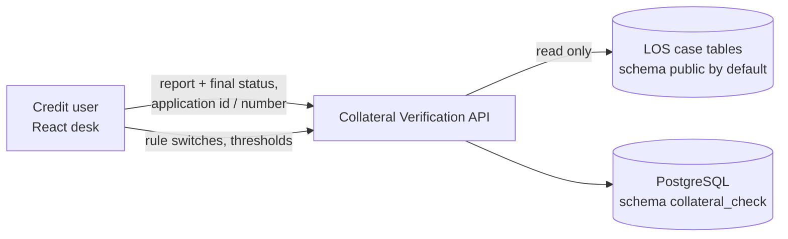

# Collateral Verification — Design

Checks a vendor's title-search / CERSAI report against the collateral record of a loan application held in the LOS
case tables. A credit user uploads the vendor report with the vendor's final status (approved / rejected); the agent
reads the report's text, extracts the vendor fields, runs up to eight comparison rules (plus a CERSAI charge check)
and returns PASS / REFER / WARNING / PENDING per rule with an overall outcome. **No model decides anything**: the rules
are deterministic Python over configurable switches and thresholds, and there is no language-model step. The vendor's
status is never overridden; a disagreement with the rules is flagged as a conflict.

| | |
|---|---|
| Backend code | `backend/agents/collateral_verification/` |
| Frontend (React) | `frontend/src/agents/collateral_verification/` |
| API base | `/api/v1/credit/collateral-verification` (mounted by `backend/main.py` through `agents/registry.py`) |
| Database | PostgreSQL `agentic_LOS`, schema `collateral_check` (agent key `collateral_verification`; `shared/config/agent_databases.yaml`) |
| Rules in force | the agent's own tables `collateral_rule_configs` + `collateral_system_settings`, seeded from `conf/rules.yaml` when empty (not the shared `rule_store`) |

---

## 1. Context



* **Authentication**: every route sits behind the LOS JWT (`require_jwt`, applied when `main.py` mounts the router).
  The agent itself checks **no scopes, permissions or branches**: any authenticated caller may verify, list results
  and change rules / settings. `updated_by` on rule and setting changes comes from the request (query parameter or
  body, default `api` / `frontend`), not from the token.
* **LOS data** is read only, from `COLLATERAL_VERIFICATION_LOS_SCHEMA` (default `los_schema: public`):
  `loan_applications`, `collateral_properties`, `collateral_property_documents`, `application_participants`,
  `customers`, `primary_applicant_kyc`.
* **No OCR**: ODG (zip + `content.xml`), PDF text layer (pypdf) and plain text are read; an image is accepted but
  yields no text, so the rules report PENDING for the missing vendor fields.

## 2. Layout

```
agents/collateral_verification/
├── api.py              HTTP only: the APIRouter, error mapping (422 / 404 / 503 / 500); no SQL, no rules
├── service.py          the use cases: verify, extract-only, rules / settings CRUD, results; live RuleConfig
├── schemas.py          request bodies (RuleUpdate, BulkRulesUpdate, SettingUpdate, BulkSettingsUpdate)
├── config.py           RuleConfig, defaults from conf/rules.yaml, settings seed rows, los_schema()
├── repository.py       CollateralRepository (Protocol) + PostgresCollateralRepository (psycopg 3 via shared.db.pg):
│                       migrations + seed, runtime config, LOS record lookup, rules / settings / results
├── rules/
│   ├── engine.py       the rules (pure functions over the record, vendor fields and RuleConfig) and summarize()
│   └── names.py        person-name normalisation and token-overlap matching
├── extract/
│   ├── __init__.py     ReportExtractor (Protocol) + DocumentExtractor
│   ├── text.py         report bytes -> text (ODG, PDF text layer, plain text; images -> no text)
│   └── fields.py       text -> vendor fields (owners, owner count, PANs, CERSAI rows, address, unit, status)
├── db/schema.py        MIGRATIONS (append-only, run once each, in order)
├── conf/rules.yaml     default rule switches, thresholds, flags, settings seed, LOS schema
├── README.md
└── tests/              rules, extraction, service, API smoke, live-PostgreSQL repository tests
```

The service receives its repository and extractor; it never opens a connection or reads a file itself.

## 3. Verification flow

There are no case statuses: each call is one stateless run, stored for audit.

```mermaid
sequenceDiagram
    participant UI as React desk
    participant API as api.py
    participant S as service.py
    participant R as repository
    UI->>API: POST /collateral/verify (final_status, application_id | application_number, report)
    API->>S: verify(...)
    S->>S: final_status in vendor_final_statuses? (else 422)
    S->>R: fetch_application (LOS tables)
    R-->>S: application, properties, documents, participants, KYC (404 / 422 if none)
    S->>S: extract text -> vendor fields
    S->>S: evaluate rules on the FIRST collateral property -> summarize
    S->>R: save_result (best effort; failure logged, result still returned)
    S-->>UI: comparison_results, source_evidence, summary, run_id
```

**Configuration lifecycle**: on the first request the service applies the migrations, seeds the rule and settings
tables from `conf/rules.yaml` if they are empty, and loads them over the defaults. Every rule / setting change reloads
the live configuration. If the database cannot be read, the current (or `conf/` default) configuration stays in use,
with a warning.

## 4. Rules

Each rule returns **PASS**, **REFER** (mismatch: manual review), **WARNING**, **PENDING** (a vendor field is
missing) or **SKIPPED** (disabled), with `db_value`, `vendor_value`, a summary and a detail.

| Rule id | Default | What it checks | Outcomes |
|---|---|---|---|
| `rule_1_owner_name` | on | application owner name(s) vs vendor owner names (token overlap ≥ `NAME_MATCH_THRESHOLD`, 0.8) | PASS / REFER / PENDING |
| `rule_2_ownership` | on | single / joint ownership vs vendor owner count | single + many = REFER; joint + one = WARNING; unaligned = REFER |
| `rule_3_applicant_is_owner` | on | an applicant or co-applicant among the vendor owners | PASS / REFER / PENDING |
| `rule_pan` | on | owner PAN, else first applicant PAN, else report applicant PAN vs CERSAI debtor-search PAN | PASS / REFER / PENDING |
| `rule_8_construction_status` | off | application vs vendor construction status | completed vs in progress = REFER; under construction vs completed = WARNING |
| `rule_9_completion_percent` | off | completion % difference within `tolerance_pp` (default `COMPLETION_TOLERANCE_PP`, 10) | PASS / REFER / PENDING |
| `rule_13_location` | on | PIN (exact), city and state (case-insensitive) | REFER on any mismatch; PENDING if a vendor field is missing |
| `rule_14_unit_number` | on | flat / house number (alphanumerics only) | PASS / REFER / PENDING |
| `rule_17_registered_deed` | on | configured, but has **no evaluator**: produces no line | — |
| `cersai_charge_review` | `FLAG_UNSATISFIED_CERSAI_CHARGE` | a CERSAI security interest reported "Not Satisfied" | REFER (legal review) |

`COMPARE_PIN` is stored and shown but not used by the engine (PIN is always compared exactly in `rule_13_location`).

## 5. Overall outcome and vendor conflict

`summarize()` over the active (not SKIPPED) lines:

* **Overall**: any REFER → `REFER`; else any WARNING → `WARNING`; else any PENDING → `PENDING`; all PASS /
  NOT_APPLICABLE → `PASS`; nothing active → `PENDING`.
* **Vendor conflict** (`FLAG_VENDOR_STATUS_CONFLICT`): vendor `approved` with overall REFER / WARNING, or vendor
  `rejected` with overall PASS → `vendor_status_conflict: true` and a `conflict_reason`, placed first in the actions.
* **Recommended actions**: one line per PENDING (obtain the missing field), REFER (send back for manual review) and
  WARNING (review the warning) rule.
* The response also carries `counts` per status and `vendor_final_status`. The agent records no decision of its own.

## 6. Data model (schema `collateral_check`)

| Table | Holds |
|---|---|
| `collateral_rule_configs` | per rule: `rule_id`, `enabled`, `label`, `tolerance_pp`, `extra_json`, `updated_by` / `updated_at` |
| `collateral_system_settings` | `setting_key`, `setting_value`, `value_type` (string / number / boolean / json), description, `updated_by` / `updated_at` |
| `collateral_verification_results` | one row per run: `run_id`, application id / number, vendor status, report file name, overall, summary, comparison results, source evidence (incl. raw extracted text) |
| `agent_logs` | WARNING+ application logs (shared) |
| `api_responses` | every POST/PUT response (append-only, shared) |

Migrations `0001`–`0003` in `db/schema.py` (`0001` the three agent tables, `0002` `agent_logs`, `0003`
`api_responses`). The SQL is unqualified; the connection's `search_path` is the agent's schema. The uploaded report
file itself is not stored, only its name and the extracted evidence.

## 7. API

| Method | Path (under `/api/v1/credit/collateral-verification`) | Permission | Purpose |
|---|---|---|---|
| GET | `/health` | JWT only | ok, version, `database_configured`, rule count |
| GET | `/config` | JWT only | the live configuration: vendor statuses, tolerance, threshold, flags, rules |
| GET | `/rules` | JWT only | the rule config rows |
| PUT | `/rules?updated_by=` | JWT only | upsert one rule (400 without `rule_id`) |
| PUT | `/rules/bulk` | JWT only | upsert several rules (`rules`, `updated_by`) |
| POST | `/rules/reload` | JWT only | reload the live configuration from the database |
| GET | `/settings` | JWT only | thresholds and flags (typed `parsed_value`) |
| PUT | `/settings?updated_by=` | JWT only | upsert one setting (`parsed_value` or `setting_value`) |
| PUT | `/settings/bulk` | JWT only | upsert several settings |
| GET | `/results?limit=&offset=&application_number=` | JWT only | stored runs, newest first (limit 1–500, default 50) |
| POST | `/collateral/extract-only` | JWT only | multipart `file`: the vendor fields read from a report (not stored) |
| POST | `/collateral/verify` | JWT only | multipart `final_status`, `application_id` or `application_number`, `report`: run the rules |

Errors are FastAPI `{"detail": "..."}`: 422 (no / empty report, bad `final_status`, no identifier, no collateral
property), 404 (no collateral record), 503 (database not available), 500 (other failure; type logged, not the text).

## 8. Frontend

`frontend/src/agents/collateral_verification/` — React 18 (in the console) + JavaScript (JSX), built with Vite 5; no UI library (own CSS).

* **App.jsx**: header (database configured or not, completion tolerance from `GET /config`) and two tabs.
* **Verify tab**: `VerifyForm` (application number or id — all digits is sent as `application_id`, otherwise
  `application_number`; vendor final status from `vendor_final_statuses`; report file) and `ResultsPanel` (REFER /
  PENDING / PASS cards counted from the rule lines, the comparison table, CERSAI and source evidence: debtor search,
  security interest, borrower / asset-owner rows, header owner, property address, raw text). `StatusChip` colours a
  status. The panel does not show `summary` (overall, WARNING lines, vendor conflict, recommended actions).
* **Rules Config tab** (`RulesConfigTab`): loads `/rules` and `/settings`, edits switches, labels, tolerances and
  settings, saves via `/rules/bulk` and `/settings/bulk`, then `POST /rules/reload`.
* API paths come from `src/api.js` (`VITE_API_BASE`, default `/api/v1/credit/collateral-verification`); calls use plain
  `fetch` with no Authorization header.

Run: from `frontend/`, `npm install && npm run dev` → http://localhost:5190/collateral_verification (the one console app;
this screen is one tab of the console). `COL_API` points this agent's API base route at another backend
(default `LOS_API`, `http://127.0.0.1:8010`). Build: `npm run build` → `frontend/dist/` (one chunk per agent).
Lists that can grow are paginated with the shared `Pagination` (`frontend/src/shared/components`).

## 9. Configuration and operations

* Settings: `backend/.env` (see `.env.example`) — `LOS_AGENTIC_DSN` (shared database; schema `collateral_check`),
  optional `COLLATERAL_VERIFICATION_DSN` (a database of its own), optional `COLLATERAL_VERIFICATION_LOS_SCHEMA` (schema
  of the LOS case tables), JWT settings.
* Rule changes are live database edits through the Rules Config tab or the `/rules` and `/settings` endpoints; no
  restart. `conf/rules.yaml` is only the seed for empty tables and the fallback when the database is down. This agent
  is **not** in `rules.sets` of `agent_databases.yaml`, so `scripts/rules.py` does not manage it and there is no
  version history beyond `updated_by` / `updated_at` on each row.
* No database configured: the service starts on the `conf/` defaults, but `/collateral/verify` cannot read the LOS
  record without a DSN.
* No demo mode, seed data or reset in this agent.
* Database schema: migrated on the first request of the process (and by `scripts/setup_agent_databases.py`).

## 10. Tests

`python -m pytest agents/collateral_verification/tests -q -p no:cacheprovider` (from `backend/`): rules, extraction,
service (fake repository + extractor) and an API smoke test need no database; `test_repository_pg.py` (marker
`live_pg`) runs only when `LOS_TEST_PG_DSN` points at a throwaway PostgreSQL. Frontend: no test script in
`package.json`.
