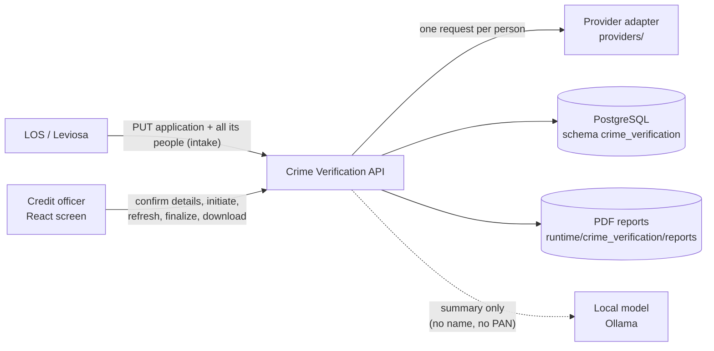
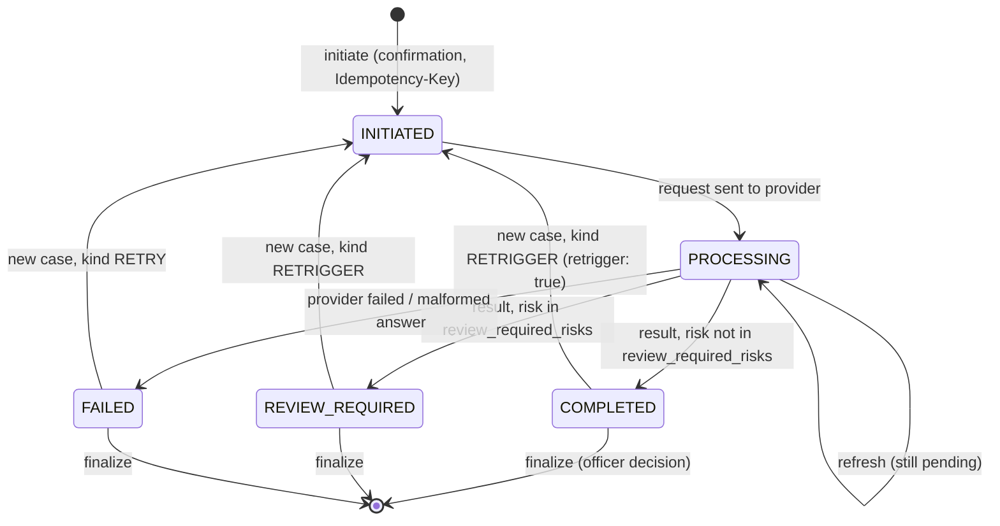

# Crime Record Verification — Design

The criminal record check of every person on a loan application: the applicant and up to ten co-applicants. A credit
officer confirms each person's details (name, father's name, date of birth, permanent address, PAN linked to the
application), initiates the check with a configured provider, reads each person's result and records an
acknowledgement. **No model decides anything**: the provider returns a risk level per person, configuration maps that
to a workflow status, the officer finalizes, and the local language model only explains the results in plain words.

| | |
|---|---|
| Backend code | `backend/agents/crime_verification/` |
| Frontend (React) | `frontend/src/agents/crime_verification/` |
| API base | `/api/v1/credit/crime-verification` (mounted by `backend/main.py` through `agents/registry.py`) |
| Database | PostgreSQL `agentic_LOS`, schema `crime_verification` (one schema per agent; `shared/config/agent_databases.yaml`) |
| Rules in force | rule set `crime_verification_policy` in the database; `conf/crime_verification.yaml` is the source of a version |

---

## 1. Context



* **Authentication**: every route sits behind the LOS JWT (`shared/security/auth.require_jwt`). Permissions are the
  union of what the token's scopes give (`access.scopes`); branches come from `access.branches` by the token's `sub`
  (`"*"` = all), and `access.all_branches_scopes` (`los.write`) sees every branch. An application or case the caller
  may not see answers like one that does not exist (404).
* **Demo grants**: in demo mode only, `access.demo_grants` adds permissions to a named user (`local-developer`).
* **Provider**: `vendors.CRIME_CHECK` uses `mock_crimecheck`, which is refused (503 `PROVIDER_NOT_CONFIGURED`) outside
  demo mode. A real vendor is a new adapter in `providers/` named in the config; nothing else changes.

## 2. Layout

```
agents/crime_verification/
├── api/routes.py           HTTP only: routes -> services (no SQL)
├── services/
│   ├── verification_service.py  initiate (API 1), refresh, finalize (API 2); provider calls; case status
│   ├── intake.py           PUT /applications/{id}: the LOS pushes an application and all its people
│   ├── queries.py          scoped reads: dashboard, worklists, case detail, status, audit, GET /config payload
│   ├── views.py            rows -> API shapes; scoped lookups; person keys and labels (role, seq); PAN masking
│   ├── summary_service.py  the plain-words summary: rules-written at once, AI rewrite in a background worker
│   ├── report_service.py   per-person and whole-case PDF reports (PyMuPDF from HTML), stored with a hash
│   ├── access.py           Caller (user, permissions, branches) from the verified token
│   └── audit.py errors.py  audit rows / ids; ServiceError -> the shared error envelope
├── domain/
│   ├── models.py           request models (ApplicationIn, InitiateRequest, FinalizeRequest), PAN masking
│   └── validation.py       one person's field rules (config `validation`), field-level errors
├── providers/
│   ├── base.py             the provider boundary: request, response, result, categories
│   ├── crimecheck_mock.py  deterministic synthetic answers from demo scenarios (demo only)
│   └── __init__.py         provider_for(name): adapter lookup
├── db/
│   ├── schema.py           MIGRATIONS (append-only, run once each, in order)
│   └── database.py         connection pool; LOS_AGENTIC_DSN or own DSN; embedded pgserver in demo mode only
├── conf/
│   ├── crime_verification.yaml          policy: access, ui, vendors, subjects, form, validation, statuses,
│   │                                    finalize, ai_summary, report
│   ├── crime_verification_wording.yaml  every sentence and label (API messages, screen, report, summary)
│   └── crime_verification_demo.yaml     samples, coverage, provider scenarios, synthetic applications
├── config.py               loads the policy from rule_store; wording / demo files; demo_mode(); reports_dir()
├── demo_data/seed.py       resets and loads the demo applications (demo mode; POST /demo/reset)
├── docs/                   API_CONTRACT, ARCHITECTURE, BUSINESS_WORKFLOW, EXPLANATION_FOR_MANAGER
└── tests/                  API tests in demo mode and in production mode
```

The code holds logic only. Statuses, risk mapping, validation, decisions and permissions are configuration.

## 3. Case lifecycle

Each **person (subject)** has a status; the **case** status is derived from its subjects
(`case_status_from_subjects`, first match wins: any PROCESSING → PROCESSING, any INITIATED → INITIATED, all WAIVED →
WAIVED, any FAILED → FAILED, any REVIEW_REQUIRED → REVIEW_REQUIRED, all COMPLETED → COMPLETED).



`WAIVED` exists in the schema and the status mapping, but no API route waives; only the demo seed writes a waived
history row.

Guards enforced by the API:

* `initiate` needs `confirmation_accepted` (422 `CONFIRMATION_REQUIRED`), an enabled vendor (422 `UNKNOWN_VENDOR`),
  at least one subject, no person twice, at most `subjects.max_co_applicants` co-applicants, each person on the
  application (422 `SUBJECT_NOT_ON_APPLICATION`), valid fields (422 `VALIDATION_ERROR`, all errors at once) and the PAN
  equal to the application's (`validation.pan_must_match_application`).
* A person whose latest check is `INITIATED` / `PROCESSING` cannot be initiated again (409 `ALREADY_IN_PROGRESS`; a
  partial unique index enforces it too). After `COMPLETED` / `REVIEW_REQUIRED` / `WAIVED` a new check needs
  `retrigger: true` and the `retrigger` permission (409 `RETRIGGER_REQUIRED`).
* The same Idempotency-Key with the same body replays the case (200, `replayed: true`); with another body → 409
  `IDEMPOTENCY_CONFLICT`.
* `finalize` needs every subject in `finalize.final_statuses` and at least one result (409 `NOTHING_TO_FINALIZE`);
  once only (409 `ALREADY_FINALIZED`). A provider result is never changed.

## 4. Risk levels and status mapping

There is no rule engine of the agent's own: the provider's risk level per person is mapped by configuration. People
are never combined into one risk.

| Risk level (provider) | Subject status | On screen |
|---|---|---|
| `NO_RISK` | COMPLETED | celebrated (`ui.celebrate_risks`) |
| `LOW_RISK` | COMPLETED | celebrated |
| `AVERAGE_RISK` | REVIEW_REQUIRED (`review_required_risks`) | flagged (`ui.alarm_risks`) |
| `HIGH_RISK` | REVIEW_REQUIRED | flagged |
| `VERY_HIGH_RISK` | REVIEW_REQUIRED | flagged |
| answer without a supported risk level | FAILED (`PROVIDER_REJECTED`) | — |
| provider error / exception | FAILED (`PROVIDER_UNAVAILABLE`) | — |

Each stored result keeps the outcome (`NO_MATCH` / `FINDINGS`), total cases, counts per source and per matter type,
and the `rule_set_hash` of the policy version it was judged with.

**Field validation** (`validation`, also sent to the screen): PAN pattern, name pattern and length, address 10–250
characters, age 18–100. The PAN cannot be changed by the officer; names and address can be corrected.

## 5. Finalize and the AI summary

**Finalize (API 2)**: decisions `ACCEPTED`, `REFER_TO_CREDIT`, `DECLINE_RECOMMENDED` (`finalize.decisions`); remarks
are required for `REFER_TO_CREDIT` and `DECLINE_RECOMMENDED`, at most 500 characters.

**Summary** (`services/summary_service.py`): a rules-written summary from the results is always available at once. If
`ai_summary.enabled` (or `CRIME_VERIFICATION_AI_SUMMARY`), one background worker asks the local model for one point
per person (`per_person: true`, `parallel: 1`). The model sees role, status, risk and counts only — never a name, PAN
or id. Each point is checked (figures from the facts, no banned words such as "approved", "criminal record", "clean
record", length limits); a refused or failed point falls back to that person's rules line. People with no matches
get no model call (`model_for_no_findings: false`). Summaries are stored by facts hash and reused; `source` says
`ai` / `refused` / `unavailable`.

## 6. Data model (schema `crime_verification`)

| Table | Holds |
|---|---|
| `crime_verification_applications` | what the LOS sent: title, branch, product, loan amount, stage, status, `is_demo` |
| `crime_verification_parties` | the people on an application: (role, seq), name, father's name, DOB, address, PAN |
| `crime_verification_cases` | one verification run: vendor, workflow status, kind (INITIAL / RETRIGGER / RETRY / WAIVER), idempotency key, final decision |
| `crime_verification_subjects` | one person in a case: confirmed details snapshot, PAN masked, status, provider reference / state, error |
| `crime_verification_results` | the provider result per subject: outcome, risk level, counts, summary, payload, `rule_set_hash` |
| `crime_verification_reports` | generated PDFs: file reference, SHA-256, size, version, content key |
| `crime_verification_summaries` | the case summary text, facts hash and source |
| `crime_verification_audit` | append-only event trail (counts and keys, never a PAN or name) |
| `rule_sets`, `rule_set_active`, `rule_set_changes` | policy versions, the one in force, who changed it and why |
| `api_responses`, `agent_logs` | every POST/PUT response (append-only); WARNING+ logs |

Migrations `0001`–`0007` in `db/schema.py` (0003 moved people to `(role, seq)` for many co-applicants; 0004 added
`is_demo`; 0006 rule sets). Composite foreign keys make it impossible to attach a person to the wrong application.

## 7. API

| Method | Path (under `/api/v1/credit/crime-verification`) | Permission | Purpose |
|---|---|---|---|
| POST | `/initiate` | initiate (+ retrigger) | API 1: confirmed details → case, subjects, provider results (Idempotency-Key header) |
| POST | `/{case_id}/finalize` | finalize | API 2: the officer's decision and remarks |
| POST | `/{case_id}/refresh` | refresh | ask the provider again for subjects still processing |
| GET | `/config` | (any caller) | validation, labels, decisions, vendors, form, UI switches, the caller's permissions |
| GET | `/dashboard` | view | counts for the dashboard tiles |
| GET | `/applications?q=` | view | the worklist (caller's branches) |
| GET | `/applications/{id}` | view | one application with its people and latest checks |
| PUT | `/applications/{id}` | manage_applications | intake from the LOS (all people; replaces the list) |
| GET | `/applications/{id}/audit` | view | the application's events |
| GET | `/cases?q=&status=` | view | cases, filterable by status |
| GET | `/cases/{id}` | view | case detail with subjects and results |
| GET | `/cases/{id}/status` | view | the case's workflow status |
| GET | `/cases/{id}/summary` | view | the plain-words summary (`pending` while the AI writes) |
| GET | `/cases/{id}/audit` | view | the case's events |
| GET | `/cases/{id}/report` | download_report | the whole case in one PDF |
| GET | `/subjects/{id}/result` | view | one person's result |
| GET | `/subjects/{id}/report` | download_report | one person's PDF report |
| POST | `/demo/reset` | reset_demo (demo only) | reload the synthetic applications |

Errors use the shared envelope `{"error": {"code", "message", "details"}}` with messages from the wording file.

**Scopes → permissions** (`access.scopes`): `los.credit.underwrite` (view, initiate, retrigger, refresh, finalize,
download_report), `los.write` (the same plus manage_applications; all branches), `los.read` (view, download_report).

## 8. Frontend

`frontend/src/agents/crime_verification/` — React 18 + TypeScript, built with Vite 5; no UI library (own CSS).

* **DashboardPage** (`#/`): tiles with counts that filter the case list; opens a case.
* **VerifyPage** (`#/verify/{id}`): find an application, a tab per person, the details form (address as line + state +
  city + PIN from `form.states`), "Fill sample" (never the PAN), a confirmation popup, then Initiate.
* **ResultsPage** (`#/case/{id}`): each person's result (`ResultPanel`, `RiskGauge`), a compact list from
  `ui.compact_people_from` people, `SummaryCard`, `FinalizePanel`, `AuditTimeline`, PDF downloads; `Celebration` /
  `Alarm` once per case for clean / flagged results (mute switch, reduced motion respected).
* Every word comes from `GET /config` (`utils/text.ts`); field rules are the server's (`utils/validate.ts`). API calls
  go through `src/services/api.ts` (same-origin `/api/v1/credit/crime-verification`).

Run: from `frontend/`, `npm install && npm run dev` → http://localhost:5190/crime_verification (the one console app;
this screen is one tab of the console). `CRV_API` points this agent's API base route at another backend
(default `LOS_API`, `http://127.0.0.1:8010`). Build: `npm run build` → `frontend/dist/` (one chunk per agent).
Lists that can grow are paginated with the shared `Pagination` (`frontend/src/shared/components`).

## 9. Configuration and operations

* Settings: `backend/.env` (see `.env.example`) — `LOS_AGENTIC_DSN` (or `CRIME_VERIFICATION_DSN` for a database of its
  own), JWT settings, `ENVIRONMENT`. Optional: `CRIME_VERIFICATION_REPORTS_DIR`, `CRIME_VERIFICATION_PGDATA` (embedded
  demo cluster), `CRIME_VERIFICATION_AI_SUMMARY` (on/off override). The model is the app's `OLLAMA_MODEL` unless
  `ai_summary.model` is set.
* Without a DSN, demo mode starts an embedded PostgreSQL (pgserver) under `storage.embedded_pgdata`; outside demo mode
  a missing DSN is an error.
* Policy changes: edit `conf/crime_verification.yaml`, then `python scripts/rules.py import crime_verification_policy
  --by "<name>" --note "<why>" --activate`. In force within `rules.cache_seconds`, no restart. The sections `storage`,
  `access`, `ui`, `ai_summary`, `report` are deployment settings, always read from the file.
* Demo mode (`demo_mode: true`) enables the mock provider, demo grants, seeding an empty database
  (`storage.seed_when_empty`), "Fill sample" and `/demo/reset`. It must be off in production. The policy file is
  currently `status: DEMO_DUMMY` (values to be confirmed by the credit / operations owner).
* Database schema: created / upgraded on first use and by `scripts/setup_agent_databases.py` (`--purge-demo` removes
  `is_demo` rows in production).

## 10. Tests

`python -m pytest -q agents/crime_verification/tests` (from `backend/`): `test_crime_verification.py` (end to end in
demo mode through the HTTP API, real signed tokens, a disposable PostgreSQL or `LOS_TEST_PG_DSN`) and
`test_crime_verification_prod.py` (production mode: intake only, mock refused, DSN required, nothing "demo" shown).
Frontend: `npm test` (Vitest + Testing Library, jsdom) in `frontend/` (`npx vitest run --project crime_verification`).
