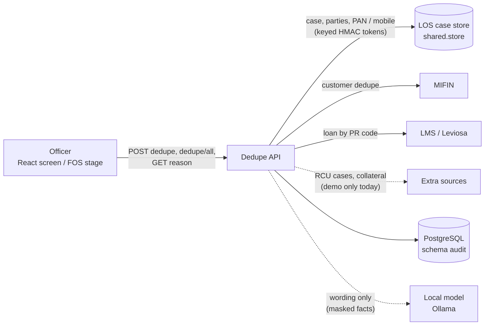

# Dedupe — Design

Finds out who the applicant already is. Given a case and one identifier (PAN, mobile, AP code = customer id, PR code =
loan account number) or all of them at once, it searches the LOS's own cases, asks MIFIN (the customer master) and
the LMS (Leviosa) for the customer's prospects and loans, and evaluates two rule sets: the LOS dedupe policy and the
customer-history policy. The credit / FOS officer uses it before the application moves on. **Rules decide, never a
model**: the answer is a dedupe status, a workflow recommendation and an outcome (`READY_FOR_DECISION` /
`REVIEW_REQUIRED` / `DATA_INSUFFICIENT` — never an approval); the local model only words the verified result.

| | |
|---|---|
| Backend code | `backend/agents/dedupe/` |
| Frontend (React) | `frontend/src/agents/dedupe/` |
| API base | `/api/v1/credit/dedupe` (router prefix `/credit`, mounted under `/api/v1` by `backend/main.py` through `agents/registry.py`) |
| Database | PostgreSQL `agentic_LOS`, schema `audit` — dedupe has no schema of its own; its audit trail and rules live with the shared audit trails (`shared/config/agent_databases.yaml`) |
| Rules in force | rule sets `dedupe_policy` and `customer_history_policy` in the `audit` schema; `conf/dedupe_policy.yaml` and `conf/customer_history_policy.yaml` are the source of a version |

---

## 1. Context



* **Authentication**: the router is mounted behind the LOS JWT (`shared/security/auth.require_jwt`). Each route also
  needs scope `los.dedupe.read` or the credit underwriting scope (`agents/underwriting/config.required_scope()`,
  default `los.credit.underwrite`, `CREDIT_REQUIRED_SCOPE` overrides).
* **Case access**: `access.authorize_claims` checks the caller may open the case; a case they may not see is refused
  the same way whether or not it exists. Matched cases the caller cannot open are redacted in the answer.
* **Confirming a possible match** (`confirm_match`) needs one of `officer_confirmation.scopes` (`los.dedupe.confirm`,
  `los.write`), else 403 `CONFIRMATION_NOT_ALLOWED`.
* **Privacy**: PAN and mobile are compared as keyed HMAC tokens (`LOS_IDENTITY_HMAC_KEY`); no PAN, mobile, name,
  DOB, full AP / PR code or account number appears in a response, log or audit line; the searched value is never
  echoed.

## 2. Layout

```
agents/dedupe/
├── api.py               HTTP only: POST /credit/dedupe, POST /credit/dedupe/all, GET /credit/dedupe/{id}/reason
├── customer_history.py  one assessment: LOS dedupe -> MIFIN match -> loan history -> policy -> outcome ->
│                        explanation -> audit line + case-timeline event (serialised per case)
├── all_parameters.py    every parameter with a value, side by side; conflict and combined recommendation
├── service.py           the LOS's own dedupe (Phase A): profiles -> comparisons -> signals -> dedupe_policy rules
├── profiles.py          who is on each case (PAN, mobile) as comparable profiles; scan mode bound
├── identity.py          parameter normalisation and keyed-HMAC match tokens
├── match.py             two profiles -> MATCH / POSSIBLE_MATCH / NO_MATCH with confidence
├── party_eval.py        applicant and each co-applicant evaluated separately, then aggregated
├── dedupe_status.py     the one dedupe status, the trigger (NEW / EXISTING / ...) and the workflow recommendation
├── match_decision.py    the officer's SAME_CUSTOMER / NOT_SAME_CUSTOMER decision, stored as a case event
├── mifin.py             MIFIN response normaliser and client (UNAVAILABLE when not configured)
├── lms.py leviosa.py    LMS record and client; Leviosa adapter (contract still UNVERIFIED)
├── loan_history.py      MIFIN + LMS -> one verified loan history (no inferred states, PARTIAL totals)
├── history_policy.py    customer_history_policy evaluated rule by rule -> outcome
├── history_summary.py   deterministic explanation + validated model wording; the 3 reason points
├── extra_sources.py     RCU / fraud cases and collateral registry (demo provider only)
├── demo_sources.py      synthetic MIFIN answers in the real response shape (MIFIN_PROVIDER=demo)
├── config.py            dedupe policy loading / validation, sign-off gate, DEDUPE_ENABLED
├── conf/
│   ├── dedupe_policy.yaml            parameters, decision / workflow, trigger, rules P01–P15, precedence
│   ├── customer_history_policy.yaml  rules H01–H14, summary / model settings, top-up conditions
│   ├── mifin.yaml leviosa_lms.yaml   how a MIFIN / Leviosa reply is read (meanings marked UNVERIFIED)
│   └── mifin_demo.yaml               synthetic customers, loans, RCU and collateral records (demo only)
└── tests/               agent, API, all-parameters, failures, reason points, status, customer history
```

## 3. Flow of one check

Dedupe keeps no case status of its own: each call is a stateless assessment, recorded in the audit trail. One check:

1. Validate the body (parameter label, value format) and the caller's access to the case.
2. **LOS dedupe** (`service.py`): search the value across LOS cases; assess this case (role swaps, document reuse,
   simultaneous / duplicate applications). AP and PR codes are not stored by the LOS → `INSUFFICIENT_DATA`, never
   "no match".
3. **MIFIN match** (`mifin.py`): `CONFIRMED_MATCH | POTENTIAL_MATCH | NO_MATCH | AMBIGUOUS | SOURCE_ERROR |
   UNAVAILABLE | MALFORMED`. A potential match stays unattributed until an officer decides it (`confirm_match`).
4. **Loan history** (`loan_history.py`): each prospect / loan, its state from the LMS when it has the loan, else
   MIFIN's mapped status, else `UNKNOWN`; totals only from LMS figures.
5. **Policies**: dedupe rules and customer-history rules (sections 4–5) → status, recommendation, outcome.
6. **Explanation**: deterministic text at once; the model's 3 reason points are fetched later via
   `GET /dedupe/{request_id}/reason` (`summary.deferred: true`).
7. **Audit**: a masked JSONL line (`DEDUPE_AUDIT_PATH`, `CUSTOMER_HISTORY_AUDIT_PATH`) mirrored into the `audit`
   schema, plus a case-timeline event.

**Trigger** (`dedupe_status.trigger`): the customer lookup is `NEW`, `EXISTING`, `POSSIBLE_EXISTING`, `CONFLICTING`
or `LOOKUP_FAILED`. A confirmed `NEW` customer does not invoke the agent (`trigger.invoke_for_new: false`) and gets
`PROCEED_TO_NEXT_STAGE`; a failed lookup is never treated as new. Co-applicants are looked up too
(`trigger.include_co_applicants`, up to `party_evaluation.max_parties` = 4).

## 4. The rules

Each rule reads one signal and ends `TRIGGERED`, `NOT_TRIGGERED`, `NOT_EVALUATED` or `EVALUATION_FAILED`. A null
threshold is an unconfigured business value: `NOT_EVALUATED`, never a pass. Both policies are `signed_off: false`
today; an unsigned policy is refused in production unless `ALLOW_UNSIGNED_DEDUPE_POLICY` /
`ALLOW_UNSIGNED_CUSTOMER_HISTORY_POLICY` is true.

**Dedupe policy** (`conf/dedupe_policy.yaml`, version `0.2.0-UNSIGNED`):

| Rule | Checks | Severity | Recommendation |
|---|---|---|---|
| P01_IDENTITY_UNIQUENESS | PAN on another customer record | HIGH | IDENTITY_CONFLICT_REVIEW |
| P01_POSSIBLE_MATCH | only the mobile shared with another record | LOW | POSSIBLE_MATCH_REVIEW |
| P02_ROLE_HISTORY | applicant ↔ co-applicant on another case | LOW | ROLE_CHANGE_REVIEW |
| P05_SAME_PRODUCT_APPLICATION | another application for the same product | MEDIUM | SIMULTANEOUS_APPLICATION_REVIEW |
| P05_DUPLICATE_WINDOW | same-product application within 720 h (demo value) | MEDIUM | DUPLICATE_APPLICATION |
| P06_DOCUMENT_REUSE | a file byte-identical to one on another customer's case | MEDIUM | DOCUMENT_VERIFICATION_REQUIRED |
| P13_DATA_COMPLETENESS | history read only partly (scan bound / source failed) | INFO | PARTIAL_ANALYSIS |
| P15_CONCURRENT_CREATE | two same-product creates within 60 s (demo value) | MEDIUM | DUPLICATE_APPLICATION |

`not_implemented` (always `NOT_EVALUATED` / data unavailable): P03, P04, P09, P11, P12, P16, P17, P19 (need the LMS),
P07, P20 (RCU case system), P10 (collateral registry), P18 (credit bureau). The overall LOS-dedupe recommendation is
the first present in `recommendation_precedence` (`DATA_UNAVAILABLE` first, `CONTINUE_STANDARD_ONBOARDING` last).

**Customer-history policy** (`conf/customer_history_policy.yaml`, version `0.1.0-UNSIGNED`):

| Rule | Checks | Severity | Outcome (reason code) |
|---|---|---|---|
| H01_SOURCE_AVAILABLE | MIFIN unavailable / errored / malformed | HIGH | DATA_INSUFFICIENT (MIFIN_UNAVAILABLE) |
| H02_IDENTITY_RESOLVED | match potential or ambiguous | MEDIUM | REVIEW_REQUIRED (IDENTITY_NOT_CONFIRMED) |
| H03_HISTORY_COMPLETE | a loan's state not known from Leviosa | MEDIUM | DATA_INSUFFICIENT (LOAN_HISTORY_INCOMPLETE) |
| H04_NO_CONFLICTING_RECORDS | same reference with different facts | HIGH | REVIEW_REQUIRED (CONFLICTING_LOAN_RECORDS) |
| H05_NO_UNKNOWN_LOAN_STATUS | loans with unknown status | MEDIUM | DATA_INSUFFICIENT (LOAN_STATUS_UNKNOWN) |
| H06_ADVERSE_HISTORY | a loan settled or written off | HIGH | REVIEW_REQUIRED (ADVERSE_LOAN_HISTORY) |
| H07_EXISTING_LOAN_COUNT | live loans ≥ 3 (demo value) | MEDIUM | REVIEW_REQUIRED (EXISTING_LOAN_LIMIT) |
| H08_TOTAL_EXPOSURE | live exposure + request > Rs 50 lakh (demo) | HIGH | REVIEW_REQUIRED (CUSTOMER_EXPOSURE_LIMIT) |
| H09_EMI_BURDEN | existing EMI > Rs 50,000 / month (demo) | MEDIUM | REVIEW_REQUIRED (EMI_BURDEN_LIMIT) |
| H10_DPD | worst DPD in 12 months > 30 days (demo) | HIGH | REVIEW_REQUIRED (DPD_LIMIT) |
| H11_TOPUP_ELIGIBILITY | running loan fails the `topup` conditions | MEDIUM | REVIEW_REQUIRED (TOPUP_NOT_ELIGIBLE) |
| H12_EMI_BOUNCES | > 2 EMI bounces in 12 months (demo) | HIGH | REVIEW_REQUIRED (EMI_BOUNCES) |
| H13_FRAUD_HISTORY | RCU case confirmed or under investigation | HIGH | REVIEW_REQUIRED (FRAUD_HISTORY) |
| H14_COLLATERAL_REUSE | a property also pledged by another customer | HIGH | REVIEW_REQUIRED (COLLATERAL_REUSE) |

Each LOS-dedupe recommendation listed in `los_dedupe_contributions` also adds `REVIEW_REQUIRED` with its own reason
code (`LOS_IDENTITY_CONFLICT`, `LOS_DOCUMENT_REUSE`, ...).

## 5. Status, recommendation and explanation

* **Outcome** (customer history): precedence `DATA_INSUFFICIENT` > `REVIEW_REQUIRED` > `READY_FOR_DECISION`.
  `READY_FOR_DECISION` only when every rule evaluated and none fired; an unconfigured limit keeps it at
  `REVIEW_REQUIRED`.
* **Dedupe status** (`dedupe_status.py`): `DUPLICATE_FOUND` (needs a signed-off policy; otherwise the same evidence is
  `POSSIBLE_DUPLICATE`), `POSSIBLE_DUPLICATE`, `NO_DUPLICATE_FOUND`, `CHECK_INCOMPLETE` (a required search did not
  run). Action per status from `decision.actions` (`MANUAL_REVIEW` / `CONTINUE`).
* **Workflow recommendation** (`decision.workflow`): `NO_DUPLICATE_FOUND` → `PROCEED_TO_NEXT_STAGE`;
  `POSSIBLE_DUPLICATE`, `CHECK_INCOMPLETE` → `HOLD_FOR_REVIEW`; `DUPLICATE_FOUND` → null → `UNABLE_TO_DECIDE` with the
  configured question to the business owner. Any triggered customer-history rule, or PAN / name / DOB differing from
  the MIFIN record, turns `PROCEED` into `HOLD_FOR_REVIEW` (`decision.rule_findings`).
* **All parameters**: when two parameters name different MIFIN customers → `HOLD_FOR_REVIEW`
  (`PARAMETERS_POINT_TO_DIFFERENT_CUSTOMERS`); otherwise the most serious row by `precedence`.
* **Explanation** (`history_summary.py`): the model (`summary.model`, Ollama) sees only masked, verified facts. Its
  text is rejected for any number or date not in the facts, decision language, a full code / PAN / mobile, or an
  outcome other than the computed one; then the deterministic text stands. Reason points: exactly 3, cached
  `reason_cache_seconds` (900 s) in memory per caller.

## 6. Data model (schema `audit`)

| Table | Holds |
|---|---|
| `audit_dedupe_decisions` | each LOS-dedupe decision: case, policy version, status, recommendation, rule outcomes (JSONB), coverage, `rule_set_hash`, `is_demo` |
| `audit_customer_history` | each customer-history check: parameter name (not value), party role, match, history status, outcome, reason codes, explanation source |
| `rule_sets`, `rule_set_active`, `rule_set_changes` | policy versions, the one in force, who changed it and why |
| `api_responses`, `agent_logs` | every POST response of `/api/v1/credit/dedupe` (masked); WARNING+ logs |

The `audit` schema also holds other agents' trails (risk decisions, agent runs, issuer checks, field corrections).
Migrations in `shared/db/audit_store.py`: `audit-0001` (tables), the shared logs migration, `audit-0002`
(`rule_sets`, `rule_set_hash`, append-only), `rules-0001`, `responses-0001`. Rows arrive from the JSONL audit files
through a background writer; a request never waits for it. Every audit table is append-only (only demo rows may be
deleted). An officer's match decision is a case event in the LOS store, not a dedupe table.

## 7. API

| Method | Path (under `/api/v1/credit`) | Scope | Purpose |
|---|---|---|---|
| POST | `/dedupe` | `los.dedupe.read` or `los.credit.underwrite` (+ `los.dedupe.confirm` / `los.write` with `confirm_match`) | one parameter: LOS dedupe, MIFIN match, loan history, rules, outcome, explanation |
| POST | `/dedupe/all` | same | every parameter (PAN, mobile, AP code, PR code; missing ones taken from the case record) side by side |
| GET | `/dedupe/{request_id}/reason` | same | the model's 3 reason points for an earlier check (else the deterministic ones) |

Body fields: `case_id`, `parameter` (alias `dedupe_parameter`), `value` (alias `dedupe_parameter_value`),
`customer_type`, `party_role` (alias `check_for`), `confirm_match`, `candidate`, `requested_product`,
`requested_amount`. Errors: 401, 403, 404 `CASE_NOT_FOUND`, 404 `REASON_NOT_FOUND`, 409 `NOTHING_TO_CONFIRM`, 422
`INVALID_PARAMETER_VALUE` / `NOTHING_TO_CHECK`, 500 `POLICY_INVALID`, 503 `CASE_STORE_UNAVAILABLE`.

## 8. Frontend

`frontend/src/agents/dedupe/` — React 18 + TypeScript, built with Vite 5 (plain CSS, no component library).

* **App.tsx**: shell (navigation, stepper, toasts) and three jobs.
* **ApplyForm** — New application: the form from `GET /api/v1/fos/form-schema`, creates the case with
  `POST /api/v1/fos/applicants`, then runs dedupe on it. **Dependency on the full LOS**: this service does not mount
  `/api/v1/fos/*` (nor `/api/v1/auth/login|refresh` used by the sign-in dialog), so this page only works against the
  full LOS backend.
* **LookupForm** — Check an existing case: case id, applicant / co-applicant, customer type, one parameter or All.
* **Result** / **AllResult**: outcome, previous loans, policy rules, "Why this recommendation" points, customer / LOS /
  source panels; for All, a row per parameter and whether they agree.
* **Dialogs**: "Open this case?" and "Sign in". `src/core.ts` holds the page logic without DOM.
* `src/services/api.ts`: bearer token in `sessionStorage` (`los-copilot-token`), 401 → sign-in and retry;
  `public/ui_text.json` (wording) and `public/sample_config.json` (Fill sample pools) read at runtime.

Run: from `frontend/`, `npm install && npm run dev` → http://localhost:5190/dedupe (the one console app;
this screen is one tab of the console). `DDP_API` points this agent's API base route at another backend
(default `LOS_API`, `http://127.0.0.1:8010`). Build: `npm run build` → `frontend/dist/` (one chunk per agent).
Lists that can grow are paginated with the shared `Pagination` (`frontend/src/shared/components`).

## 9. Configuration and operations

* Settings: `backend/.env` — `LOS_AGENTIC_DSN` (the `audit` schema; `LOS_AUDIT_DSN` overrides), JWT settings,
  `ENVIRONMENT`, `LOS_IDENTITY_HMAC_KEY` (required in production; `key_id:secret[,...]`).
* Sources: `MIFIN_PROVIDER` (`demo` for synthetic data), `MIFIN_DEDUPE_URL`, `MIFIN_DEDUPE_TOKEN`,
  `MIFIN_DEDUPE_REQUEST_TEMPLATE`, `MIFIN_CONFIG_PATH`, `MIFIN_DEMO_PATH`; `LMS_PROVIDER` (`leviosa`, `demo`,
  `leviosa-demo`), `LEVIOSA_LMS_URL`, `LEVIOSA_LMS_TOKEN`; `RCU_PROVIDER`, `COLLATERAL_PROVIDER` (only `demo` exists).
  Unset → `UNAVAILABLE`, never "no match".
* Policy files: `DEDUPE_POLICY_PATH`, `CUSTOMER_HISTORY_POLICY_PATH`; `DEDUPE_ENABLED` (default on);
  audit files `DEDUPE_AUDIT_PATH`, `CUSTOMER_HISTORY_AUDIT_PATH` (default `runtime/audit/*.jsonl`).
* Policy changes: edit the yaml, then `python scripts/rules.py import dedupe_policy --by "<name>" --note "<why>"
  --activate` (same for `customer_history_policy`). In force within `rules.cache_seconds` (60 s). `main.py` checks
  the dedupe policy and the identity key at start-up.
* Demo mode: `MIFIN_PROVIDER=demo` / `LMS_PROVIDER=demo` use `conf/mifin_demo.yaml`; refused in production; every
  result is marked `is_demo`. Thresholds marked `DEMO_DUMMY` await the business's values.

## 10. Tests

`python -m pytest -q agents/dedupe/tests` (from `backend/`) covers the LOS dedupe, customer history, all parameters,
API, source failures, reason points and the dedupe status. Frontend: `npm test` (Vitest, jsdom) in `frontend/` (`npx vitest run --project dedupe`).
