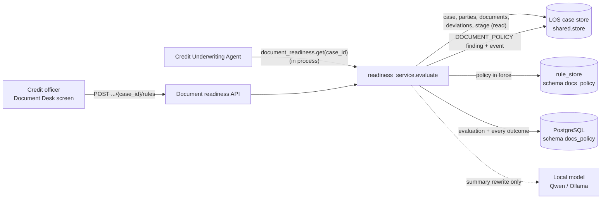
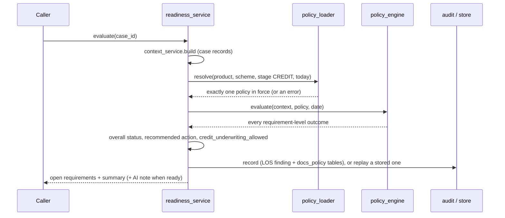

# Credit Document Policy (Document Desk) — Design

Answers one question for a loan case: is its document set complete enough for credit underwriting to start? The
credit officer (through the Document Desk screen) and the Credit Underwriting Agent (through an in-process adapter)
both call the same entry point. It reads the case, its parties, documents, deviations and stage from the case's own
records, resolves the one approved policy in force for the product, and runs eleven deterministic rules. **No model
decides anything**: the rules produce the status, the open items and the recommended action; the local model (Qwen)
only rewrites the summary as a short note.

| | |
|---|---|
| Backend code | `backend/agents/docs_policy/` |
| Frontend (React) | `frontend/src/agents/docs_policy/` (Credit Document Desk) |
| API base | `/api/v1/credit/document-readiness` (router prefix `/credit`, mounted under `/api/v1` by `backend/main.py` through `agents/registry.py`) |
| Database | PostgreSQL `agentic_LOS`, schema `docs_policy` (`shared/config/agent_databases.yaml`; own DSN `DOCS_POLICY_DSN` optional) |
| Rules in force | rule set `docs_policy` in the database, one member per policy file (`docs_policy:<file>.credit.json`); `policies/*.credit.json` are the source of a version |

---

## 1. Context



* **Authentication**: every route sits behind the LOS JWT (`shared/security/auth.require_jwt`). The caller needs one
  of the scopes in `DOCS_CREDIT_SCOPES` (default `los.credit.underwrite`) or the service write scope, else 403
  `INSUFFICIENT_SCOPE` (`api/dependencies.evaluator`).
* **Case access**: `shared.security.access.authorize_claims` runs before any case data is read; the answer is the same
  403 whether or not the case exists.
* **Nothing comes from the caller**: the request body carries only an optional `correlation_id` (any other field is
  refused). The stage is never advanced here.

## 2. Layout

```
agents/docs_policy/
├── api/
│   ├── routes.py                   HTTP only: the readiness route and the dashboard's rules route
│   └── dependencies.py             scope check on the token; case access check
├── services/
│   ├── readiness_service.py        ONE evaluation end to end: context -> policy -> rules -> status/action -> audit
│   ├── context_service.py          the case from its authoritative records (parties, stage, documents, deviations)
│   ├── policy_engine.py            the rules, deterministic, over one case and one resolved policy
│   ├── reconciliation_service.py   required vs available for one party and one slot (rules 2, 3, 5, 8)
│   ├── document_inventory_service.py  what a stored document counts for, from its recorded state
│   ├── exception_service.py        RULE-09: approved deviations only, never granted here
│   ├── file_service.py             RULE-11: real file format (first bytes) and size
│   ├── dates.py                    strict date parsing (unreadable = None, never guessed)
│   ├── audit_service.py            RULE-10: CaseFinding + case event in the LOS case store
│   ├── store_service.py            the agent's own tables (MIGRATIONS), idempotent save
│   ├── summary_service.py          headline, missing / not satisfied, route, next step; optional AI note
│   └── board_service.py            the dashboard's rule board (PASS / WARN / FAIL / N/A / OFF)
├── config/
│   ├── policy_loader.py            which policy applies (resolved, never guessed); validator for rules.py import
│   ├── settings.py                 environment settings (no secrets)
│   ├── reasons.py / reasons.yaml   rule names, every reason sentence, error messages
│   ├── wording.yaml                the summary's words, route labels, AI summary settings
│   └── dashboard.yaml              dashboard sections, labels, one-line and long rule explanations
├── models/                         application (CaseContext), policy (validated model), requirement (Outcome),
│                                   response (EvaluateRequest, ReadinessResponse)
├── integrations/
│   ├── credit_underwriting_adapter.py        the Credit Underwriting Agent's reader (signal document_readiness.status)
│   └── existing_document_agents_adapter.py   the document pipeline's recorded results, read only
├── policies/                       home_loan / loan_against_property / personal_loan .credit.json; example_policy.json
│                                   (format only, never loaded); README.md (the policy keys)
└── tests/                          policy engine and agent / API tests
```

The code holds logic only. Required documents, periods, accepted types, waivers, file limits and which outcomes are
critical are policy; sentences and labels are config.

## 3. Evaluation flow

There are no case statuses held by this agent: each call is a fresh, stateless evaluation.



* **Policy resolution** fails loudly, never into a result: no product (`CONTEXT_INCOMPLETE`), none matching
  (`POLICY_NOT_CONFIGURED`), two matching (`POLICY_AMBIGUOUS`), a file that does not validate (`POLICY_INVALID`), a
  `SAMPLE` policy outside development (`POLICY_NOT_APPROVED`) — all 422.
* **Deadline**: the evaluation runs in a worker pool with `DOCS_CREDIT_TIMEOUT_SECONDS` (default 10); late → 504
  `EVALUATION_TIMEOUT`.
* **Audit required**: when `DOCS_CREDIT_REQUIRE_AUDIT` is true (default) an evaluation that cannot be recorded is 503
  `AUDIT_UNAVAILABLE`, never a result. Same facts + policy + date → the stored evaluation is replayed.

## 4. The eleven rules

Each outcome has a status (`SATISFIED`, `WAIVED`, `ACTION_REQUIRED`, `PENDING_VERIFICATION`, `UNDER_REVIEW`,
`MISMATCH`, `UNRESOLVED`, `EXCEPTION_PENDING`), a severity (`BLOCKING` / `NON_BLOCKING`) and a recommended action.
Names from `config/reasons.yaml`; grouping from `config/dashboard.yaml`.

| Rule | Name | What it checks | Outcome when not met |
|---|---|---|---|
| RULE-01 | Product Requirements | the product's document list for the stage, from the existing product policy engine (`base.through_stage`) | a conflict inside that policy: UNRESOLVED, blocking, `RESOLVE_POLICY_CONFIGURATION` |
| RULE-02 | Applicant Coverage | each party has its own documents per `parties` (co-applicant never borrows the applicant's) | a role the policy does not cover: UNRESOLVED, blocking |
| RULE-03 | Missing Documents | every mandatory requirement has an accepted document on file | ACTION_REQUIRED, `REQUEST_DOCUMENTS` |
| RULE-04 | Conditional Requirements | documents a case detail calls for (e.g. self-employed → ITR, business photos) | missing case detail: UNRESOLVED, `CAPTURE_APPLICATION_DATA` (blocks only if `unevaluated_conditions_block`) |
| RULE-05 | Alternative Documents | only the policy's `accepts` list counts; `same_kind` alternatives are reported | ACTION_REQUIRED (not a permitted alternative) |
| RULE-06 | Period and Freshness | months covered, latest date, count, expiry (`period_and_freshness`) | stale: `REQUEST_FRESH_DOCUMENT`; unreadable date: UNRESOLVED, `RECHECK_DOCUMENT` |
| RULE-07 | Supporting Documents | a document that must travel with another (ITR + computation) | ACTION_REQUIRED, non-blocking in the shipped policies |
| RULE-08 | Cross-Stage Reconciliation | earlier-stage (FOS / CPA) documents reused; `collect_at_stage` types uploaded after entering the stage | `REQUEST_FRESH_DOCUMENT` / `RECHECK_DOCUMENT` |
| RULE-09 | Exceptions and Waivers | only an APPROVED deviation mapped in `exceptions` waives a slot (maker-checker, never here) | pending: EXCEPTION_PENDING, `AWAIT_EXCEPTION_APPROVAL`; allowed but none: `RAISE_EXCEPTION` |
| RULE-10 | Compliance and Audit | every evaluation recorded with policy version and inputs | cannot be switched off; unrecorded → 503 |
| RULE-11 | File Size and Format | each uploaded file's real format (magic bytes) and size (`file_rules`) | `REQUEST_FRESH_DOCUMENT`; unknown format: UNRESOLVED |

**Severity**: a slot outcome is blocking only when the policy says so and its kind is in `critical_when` (shipped:
`MISSING`, `NOT_ACCEPTED`, `REJECTED`, `MISMATCH`, `EXCEPTION_PENDING`). A stale statement, a file to re-upload or a
document still being verified is non-blocking.

**Switching rules off**: the policy's `rules` map, plus `DOCS_CREDIT_RULES_OFF` (e.g. `RULE-07,RULE-11`). RULE-10
is never switched off.

## 5. Status, action and route

* **overall_status** (blocking open outcomes only): `ACTION_REQUIRED` if any is open other than an exception
  pending; `EXCEPTION_PENDING` if only exceptions wait; `COMPLETE` if nothing blocking is open.
* **recommended_action**: `PROCEED` when complete and at the stage (`AWAIT_CREDIT_STAGE` when not); otherwise the most
  urgent blocking action in this order: `RESOLVE_POLICY_CONFIGURATION`, `CAPTURE_APPLICATION_DATA`,
  `REQUEST_DOCUMENTS`, `REQUEST_FRESH_DOCUMENT`, `RECHECK_DOCUMENT`, `AWAIT_VERIFICATION`, `RAISE_EXCEPTION`,
  `AWAIT_EXCEPTION_APPROVAL`.
* **credit_underwriting_allowed** = `COMPLETE` and the case is at the policy's stage. Computed, never configured.
* **summary** (`services/summary_service.py`, words in `config/wording.yaml`): headline, missing, not satisfied,
  next step and a route — `MOVE_AHEAD`, `MOVE_AHEAD_WITH_NOTES`, `REFER_TO_AUTHORITY` (ACM / RCM),
  `AWAIT_APPROVAL`.
* **AI note**: if `ai_summary.enabled` (and `DOCS_CREDIT_AI_SUMMARY` is not `false`), the local model rewrites the
  facts in the background (`timeout_seconds: 0`: the answer never waits). The first call carries the rules-built note
  with `pending: true`; a checked AI note is served on later calls. Refused, slow or down → `source: "rules"`.
* **Rule board** (dashboard only): PASS / WARN (open, non-blocking) / FAIL (blocking open) / N/A / OFF per rule,
  built from the same outcomes.

## 6. Data model (schema `docs_policy`)

| Table | Holds |
|---|---|
| `docs_policy_evaluations` | one row per evaluation: case, stage, overall status, action, policy id / version / status / file hash, input hash, counts, reused documents, waivers, `rule_set_hash`, `is_demo`; unique `(case_id, input_hash)` |
| `docs_policy_requirement_results` | every requirement-level outcome of an evaluation (satisfied too): rule, check, status, severity, open flag, reason, action, party, slot, evidence |
| `audit_events` | `DOCUMENT_READINESS_EVALUATED` per stored evaluation (append-only) |
| `rule_sets`, `rule_set_active`, `rule_set_changes` | policy versions, the one in force, who changed it and why |
| `api_responses`, `agent_logs` | every POST response (append-only); WARNING+ logs |

Migrations (in `services/store_service.py`, append-only): `docs-0001` (the two agent tables), `common-audit-0001`,
`common-logs-0001`, `docs-0002` (rule_sets, `rule_set_hash`, audit append-only), `rules-0001`, `responses-0001`.

The LOS case store also keeps a `DOCUMENT_POLICY` CaseFinding and a `DOCUMENT_READINESS_EVALUATED` case event per
evaluation (`audit_service.py`). `--purge-demo` deletes rows with `is_demo` (cases starting `DEMO-`).

## 7. API

| Method | Path (under `/api/v1/credit/document-readiness`) | Permission | Purpose |
|---|---|---|---|
| POST | `/{case_id}` | scope in `DOCS_CREDIT_SCOPES` + case access | open requirements only (`[]` when complete), status, action, `credit_underwriting_allowed`, audit block, summary |
| POST | `/{case_id}/rules` | same | dashboard: case header, the readiness answer, all eleven rules with sections, the document checklist |

`case_id` must match `^[A-Za-z0-9._:-]+$` (1–128 chars). Status codes: 200 evaluated; 401 no caller; 403 scope or
case access; 404 no application; 422 invalid body or policy error; 503 store / audit unavailable; 504 timeout. Error
detail: `{"code", "message", "request_id"}`.

## 8. Frontend

`frontend/src/agents/docs_policy/` — the Credit Document Desk: React 18 + TypeScript, built with Vite; no UI library (ported
CSS: `styles.css`, `ink-ember.css`, `root.css`).

* **App.tsx**: one screen; `?case=` in the URL opens a case; `/` focuses search, `Esc` closes the drawer.
* **Rail**: brand and theme toggle, Case ID search, recent cases (`localStorage`), the rules by section, legend.
* **Welcome**: shown before a case is open.
* **CaseHead**: names, case ID (copy), loan, stage, product, policy, when checked, Re-check.
* **Banner**: the route banner, filter counts (Critical / Approval / To collect / Verified) and the underwriting gate.
* **People**: one checklist card per person, one row per required document.
* **Brief**: the underwriter brief (AI or rules note, open items, Copy) and the next step.
* **Drawer**: one document's or one rule's details. **Toast**: short messages.
* `src/services/api.ts` calls only `POST /api/v1/credit/document-readiness/{case_id}/rules` on the same origin; no
  token is stored. The page computes no status.

Run: from `frontend/`, `npm install && npm run dev` → http://localhost:5190/docs_policy (the one console app;
this screen is one tab of the console). `DCP_API` points this agent's API base route at another backend
(default `LOS_API`, `http://127.0.0.1:8010`). Build: `npm run build` → `frontend/dist/` (one chunk per agent).
Lists that can grow are paginated with the shared `Pagination` (`frontend/src/shared/components`).

## 9. Configuration and operations

* Settings: `backend/.env` (see `.env.example`) — `LOS_AGENTIC_DSN` (or `DOCS_POLICY_DSN` for a database of its
  own), JWT settings, `ENVIRONMENT`. Without a DSN nothing is written to the agent's tables.
* Agent environment (`config/settings.py`): `DOCS_CREDIT_POLICY_DIR`, `DOCS_CREDIT_ALLOW_SAMPLE_POLICY` (default true
  only in development / dev / local / test), `DOCS_CREDIT_REQUIRE_AUDIT` (default true),
  `DOCS_CREDIT_TIMEOUT_SECONDS` (default 10), `DOCS_CREDIT_SCOPES`, `DOCS_CREDIT_STAGE` (default `CREDIT`),
  `DOCS_CREDIT_RULES_OFF`, `DOCS_CREDIT_AI_SUMMARY`.
* Policy changes: copy the policy file, raise `version`, set `status: APPROVED` with `approval`, set effective dates so
  exactly one is in force, then `python scripts/rules.py import docs_policy --by "<name>" --note "<why>" --activate`
  (from `backend/`; `import docs_policy` imports every file, `docs_policy:home_loan.credit.json` one member). In
  force within `rules.cache_seconds` (60 s), no restart.
* Demo: evaluations of LOS demo cases (`DEMO-` prefix) are stored with `is_demo`; `scripts/setup_agent_databases.py
  --purge-demo` removes them. The shipped policies are `SAMPLE` and are refused outside development.
* Database schema: created / upgraded by `scripts/setup_agent_databases.py`.

## 10. Tests

`python -m pytest -q agents/docs_policy/tests` (from `backend/`): `test_policy_engine.py` (the rules) and
`test_docs_verify_credit_agent.py` (agent, policy resolution, audit and API). Frontend: `npm test` (Vitest:
`app.test.tsx`, `proxyRules.test.ts`) in `frontend/` (`npx vitest run --project docs_policy`).
