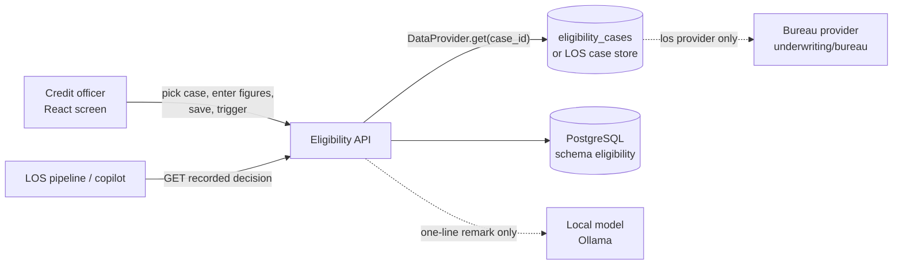
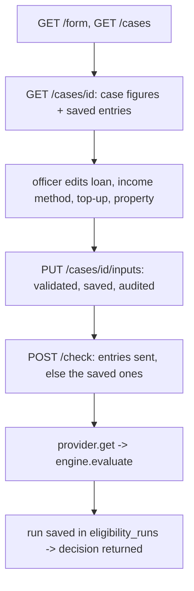

# Eligibility — Design

Decides whether a loan case is eligible and for how much, from the case's structured applicant data (never from a
document). A credit officer picks a case, enters the loan terms, the income working (by method), a top-up and the
property figures, saves them and triggers the check; the LOS reads the decision recorded on a case. **No model
decides anything**: six config-driven rules, the product terms and the LTV grid give APPROVED / CONDITIONAL / REFER /
REJECTED / DATA_MISSING with the eligible amount and EMI; the local language model only writes an optional one-line
remark, checked against the result's own figures.

| | |
|---|---|
| Backend code | `backend/agents/eligibility/` |
| Frontend (React) | `frontend/src/agents/eligibility/` |
| API base | `/api/v1/eligibility` (mounted by `backend/main.py` through `agents/registry.py`) |
| Database | PostgreSQL `agentic_LOS` (the database `LOS_AGENTIC_DSN` names), schema `eligibility` (`shared/config/agent_databases.yaml`) |
| Rules in force | rule set `eligibility_policy` in the database; `conf/eligibility_config.yaml` is the source of a version |

---

## 1. Context



* **Authentication**: every route sits behind the LOS JWT (`main.py` mounts each router with `require_jwt`). Running
  checks, reading runs, the screen's form / cases and saving entries need the scope `agents:execute`
  (`require_scope("agents:execute")` on each route). `GET /{case_id}` reads through the `eligibility.get` capability
  (`shared/applicant/permissions`: tool permission plus applicant/case ownership); a refusal is audited and answers 403.
* **Data source**: config `data_provider` (env `ELIGIBILITY_DATA_PROVIDER` wins): `postgres` reads the
  `eligibility_cases` table; `los` reads the LOS case store and the bureau (score and obligations, timeout
  `los.bureau_timeout_seconds`). A missing case is 404, an unreachable source 503 — never a decision.
* **Every check is audited** (`shared.applicant.audit`, intent `ELIGIBILITY_CHECK`, plus `audit_events` rows written
  with each run / saved entry).

## 2. Layout

```
agents/eligibility/
├── api.py               HTTP: request models (PopupInputs, CheckRequest), routes, error -> status mapping
├── agent.py             the orchestration entry: assess_payload {case_id, overrides} -> eligibility | error
├── config.py            the rule set (database, else file outside production), the demo-policy production guard
├── calc/
│   ├── engine.py        the flow: income / top-up, mandatory data, rules in config order, sizing, decision
│   ├── rules.py         one function per rule (AGE, INCOME, SCORE, DPD, FOIR, LTV) and the REGISTRY
│   ├── income.py        income by method (SALARIED, ITR, CASH_PROFIT, GROSS_PROFIT, ASSESSED) with the working
│   ├── topup.py         BT_TOPUP / INTERNAL_TOPUP from the months-on-book ladders
│   ├── ltv.py           the LTV limit: collateral x occupancy grid, else product limit; RBI slabs for HOME_LOAN
│   ├── offer.py         ticket bucket, amount to offer, longer-tenure option, "what it would take"
│   └── finance.py       EMI, inverse EMI, FOIR, LTV, rounding, Indian money formatting (pure)
├── data/
│   ├── providers.py     PostgresDataProvider / LosDataProvider behind one DataProvider interface
│   ├── runs.py          save / read a check run (eligibility_runs + an audit_events row)
│   ├── inputs_store.py  the officer's saved entries per case (eligibility_inputs)
│   ├── migrations.py    the versioned migrations, store_dsn, seed_demo, PURGE_DEMO_SQL
│   ├── schema.sql       migration elig-0001 (released; never edited)
│   ├── demo_seed.sql    synthetic demo cases (is_demo = true)
│   └── dev_db.py        development only: falls back to the embedded PostgreSQL when the DSN is unreachable
├── domain/
│   ├── models.py        EligibilityInput, RuleResult, EligibilityResult, Decision
│   └── requests.py      validated request blocks (income, top-up, collateral, occupancy) with config bounds
├── output/
│   ├── response.py      the final response, every sentence a config template filled with the result's figures
│   └── summary.py       the optional model remark (plain and streamed), figure-checked
├── conf/eligibility_config.yaml   rules, products, LTV grid / slabs, income methods, top-up ladders, form, wording
└── tests/               engine, numbers, workbook, negative cases, config strictness, explain, Postgres
```

The code holds logic only; every limit, rule order, product term, label and sentence is configuration.

## 3. Case lifecycle

The agent keeps no case status; each check is an independent saved run. The screen's flow:



The engine's steps (`calc/engine.py`): (1) the officer's income method / top-up replace the declared figures for this
check only; (2) mandatory data (`mandatory_fields`, plus `mandatory_with_ltv` for secured products, the rate and the
product's tenure range); (3) the rules in the order of `rules.checks`; (4) sizing: eligible = min(requested, every
sizing cap, product maximum, top-up cap), rounded down to `rules.round_down_to`; (5) the offer (`calc/offer.py`).

A run that cannot be saved still returns the decision, without `run_id`. Errors are never decisions: 404 no case,
503 data source / bureau down or rules not approved here (`CONFIG_NOT_APPROVED`).

## 4. The rules

Each rule returns pass / fail / missing / not_applicable with the value and the limit it compared. Kind comes from
config: a **knockout** fail rejects; a **sizing** fail caps the amount instead.

| Rule | What it checks (limits from `rules.*`, demo values) | Kind | Borderline -> REFER |
|---|---|---|---|
| AGE | 21 <= age <= 60 today, and age at end of tenure <= 65 | knockout | — |
| INCOME | net monthly income (declared or by method) >= ₹25,000 | knockout | — |
| SCORE | bureau score >= 700 | knockout | within 20 points above the cut-off |
| DPD | worst DPD in 12 months <= 30; any write-off or settlement rejects | knockout | DPD 31–60 |
| FOIR | (existing EMIs + new EMI) / net income <= 50 %; caps the loan at what 50 % affords | sizing | — |
| LTV | (requested + existing exposure) / property value <= limit; secured products only | sizing | — |

The LTV limit comes from the `ltv_grid` (collateral x occupancy) when both are known, else the product's
`ltv_limit_pct`; for `HOME_LOAN` the RBI `ltv_slabs` (90 % up to ₹30 L, 80 % up to ₹75 L, 75 % above) cap it further.
Products (`products`): `PERSONAL_LOAN` (no LTV), `HOME_LOAN`, `LOAN_AGAINST_PROPERTY`, each with rate, amount and
tenure range. Missing data is never a pass: the rule reports `missing` and the case is DATA_MISSING.

## 5. Decision, offer and explanation

**Decision**, in this order (`calc/engine.py`):

| Decision | When |
|---|---|
| REJECTED | a knockout failed, or nothing is affordable / the amount is below the product minimum |
| DATA_MISSING | a mandatory field is absent, or the product has no terms (never a default, never an approval) |
| REFER | a rule passed but is borderline (score near the cut-off, DPD in the refer band) |
| CONDITIONAL | eligible for less than requested (`limiting_factor`: FOIR, LTV, product maximum or top-up) |
| APPROVED | eligible for the full amount |

**Offer** (`calc/offer.py`): the ticket bucket (`recommendation.buckets`), the amount to offer, the amount at the
longest allowed tenure (`tenure_option`) and "what it would take" for the full request. The response's `summary` and
`next_steps` are templates from `response` in the config.

**Explanation** (`output/summary.py`): with `explain: true` on `/check`, or through `/explain` and `/explain/stream`,
the local model (Ollama) writes one sentence (config `explanation`: 8 s timeout, at most 320 characters, `en` or
`hi`). It is shown only if every number is one of the result's own figures and no decision word contradicts the
decision; otherwise it is left out. It never changes the decision; `/explain` saves no run.

Every run stores the decision, amounts, FOIR, the full result, `config_version` and the hash of the rule set it ran
under (`rule_set_hash`, migration elig-0003).

## 6. Data model (schema `eligibility`)

| Table | Holds |
|---|---|
| `eligibility_cases` | the case's applicant figures (product, DOB, income, EMIs, bureau score, DPD, write-offs, settlements, property value, terms), `is_demo` |
| `eligibility_inputs` | the officer's saved entries per case (JSONB), replaced on each save |
| `eligibility_runs` | every check: decision, eligible amount, EMI, FOIR, full result, config version, requester, `rule_set_hash` |
| `audit_events` | who saved / checked what, when (append-only; only demo rows may be deleted) |
| `rule_sets`, `rule_set_active`, `rule_set_changes` | policy versions, the one in force, who changed it and why |
| `api_responses`, `agent_logs` | every POST/PUT response (masked); WARNING+ logs |

Migrations in `data/migrations.py`: `elig-0001` (`schema.sql`), `elig-0002` (is_demo, checks, indexes),
`common-audit-0001`, `common-logs-0001`, `elig-0003` (rule sets, `rule_set_hash`), `rules-0001`, `responses-0001`.
A change is always a new migration.

## 7. API

| Method | Path (under `/api/v1/eligibility`) | Permission | Purpose |
|---|---|---|---|
| POST | `/check` | `agents:execute` | check a case: entries (or saved ones) -> provider -> rules -> decision, saved as a run |
| POST | `/check-form` | `agents:execute` | the same check as a form (dropdowns + boxes); unused non-zero boxes -> 422 |
| POST | `/explain` | `agents:execute` | the model remark for the same body; no run saved |
| POST | `/explain/stream` | `agents:execute` | the remark as NDJSON (`delta` lines, then `final`) |
| GET | `/runs/{run_id}` | `agents:execute` | one saved check as it was returned |
| GET | `/form` | `agents:execute` | the screen's fields, products, income methods, top-up types, config status / version |
| POST | `/preview` | `agents:execute` | income / top-up working for figures being typed (no case, no rules, no run) |
| GET | `/cases` | `agents:execute` | the cases the screen can pick from |
| GET | `/cases/{case_id}` | `agents:execute` | one case's figures and its saved entries |
| PUT | `/cases/{case_id}/inputs` | `agents:execute` | save the officer's entries (validated like `/check`, audited) |
| GET | `/{case_id}?applicant_id=` | JWT + capability `eligibility.get` | the decision recorded on a LOS case; `stale` when the data moved |

Error statuses: 404 `CASE_NOT_FOUND` / `RUN_NOT_FOUND`, 422 validation, 503 `DATA_SOURCE_UNAVAILABLE` /
`CONFIG_NOT_APPROVED`, 502 when the recorded result cannot be read. The request id is in `X-Request-ID`.

## 8. Frontend

`frontend/src/agents/eligibility/` — React 18 + TypeScript, built with Vite (no UI library).

* **App.tsx**: state and flow (load form and cases, fetch a case, save, trigger).
* **CaseCard**: pick or type a case id; the case's read-only figures (`form.case_fields`).
* **EntryCard**: loan (product + editable terms), income method fields, top-up fields, collateral / occupancy /
  existing exposure; Save and Trigger eligibility.
* **ResultCard**: decision badge, summary, amount to offer, checks, what it would take, next steps, one-line working.
* **fields.tsx**: number / text / select inputs drawn from the form spec.
* `src/services/api.ts`: same-origin `/api/v1/eligibility` (`GET /form`, `GET /cases`, `GET /cases/{id}`,
  `PUT /cases/{id}/inputs`, `POST /check`); the app sends no token, the LOS login identifies the caller.
  `src/utils/logic.ts` holds prefill, request body, money and error wording.

Run: from `frontend/`, `npm install && npm run dev` → http://localhost:5190/eligibility (the one console app;
this screen is one tab of the console). `ELG_API` points this agent's API base route at another backend
(default `LOS_API`, `http://127.0.0.1:8010`). Build: `npm run build` → `frontend/dist/` (one chunk per agent).
Lists that can grow are paginated with the shared `Pagination` (`frontend/src/shared/components`).

## 9. Configuration and operations

* Settings: `backend/.env` — `LOS_AGENTIC_DSN` (or the agent's own `ELIGIBILITY_DSN`; the older `DATABASE_URL` is
  read with a warning), `ENVIRONMENT`, JWT settings.
* Other env: `ELIGIBILITY_DATA_PROVIDER` (`postgres` | `los`), `ELIGIBILITY_CONFIG_PATH` (another policy file),
  `ELIGIBILITY_ALLOW_DEMO_POLICY` (see below).
* Policy changes: edit `conf/eligibility_config.yaml`, then `python scripts/rules.py import eligibility_policy --by
  "<name>" --note "<why>" --activate`. In force within `rules.cache_seconds` (60 s), no restart. The sections
  `postgres`, `los` and `explanation` are deployment settings, always read from the file.
* **Demo policy guard**: the shipped file is `status: DEMO_NON_PRODUCTION`, version `2.0-demo`. A non-CONFIRMED
  policy runs only in development / dev / local / test, in staging / uat / qa / preprod / sandbox only with
  `ELIGIBILITY_ALLOW_DEMO_POLICY=true`, and never in production or with `ENVIRONMENT` unset — startup fails
  (`validate_for_startup`) and checks answer 503 `CONFIG_NOT_APPROVED`.
* Database: `scripts/setup_agent_databases.py` applies the migrations; `--seed-demo` loads `demo_seed.sql`
  (is_demo = true); `--purge-demo` removes demo cases, their entries, runs and audit rows. In development `dev_db.py`
  falls back to the embedded PostgreSQL when the DSN is unreachable — never in production.

## 10. Tests

`python -m pytest -q agents/eligibility/tests` (from `backend/`) covers the engine and rules, the workbook formulas,
numbers, negative inputs, strict config, the explanation check and the Postgres store. Frontend: `npm test` (Vitest,
render + logic with captured API answers in `src/test/fixtures.json`) in `frontend/` (`npx vitest run --project eligibility`).
