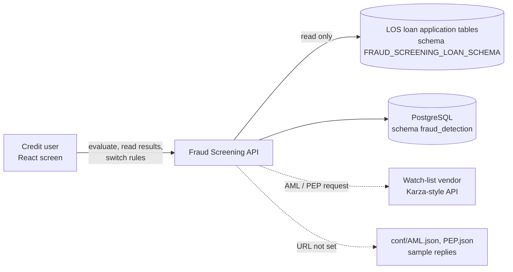
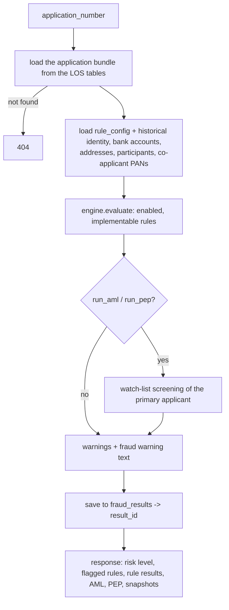

# Fraud Screening — Design

Rule-based fraud screening of a loan application already stored in the LOS database. A credit user enters an
application number; the agent loads the application (primary applicant, co-applicants, KYC, addresses, bank
accounts) and earlier applications, evaluates every enabled fraud rule, optionally runs **AML** and **PEP**
watch-list screening, and stores the outcome. **No model is involved**: deterministic rules give a risk level
(LOW / MEDIUM / HIGH / CRITICAL) and AML / PEP matching is fuzzy string comparison against vendor (or sample) replies;
the reviewer reads the evidence and decides.

| | |
|---|---|
| Backend code | `backend/agents/fraud_screening/` |
| Frontend (React) | `frontend/src/agents/fraud_screening/` |
| API base | `/api/v1/credit/fraud-screening` (mounted by `backend/main.py` through `agents/registry.py`) |
| Database | PostgreSQL `agentic_LOS` (the database `LOS_AGENTIC_DSN` names), schema `fraud_detection` (`shared/config/agent_databases.yaml`) |
| Rules in force | table `rule_config` in the agent's schema (seeded by migration 0001, edited through `PATCH /rules/{rule_key}`); thresholds in `conf/fraud_screening.yaml` |

---

## 1. Context



* **Authentication**: every route sits behind the LOS JWT (`main.py` mounts each router with
  `dependencies=[Depends(require_jwt)]`). The router itself checks **no scope or permission**: any valid token may
  evaluate, read results and change rules (including `PATCH /rules/{rule_key}`).
* **LOS data is read, never written**: `loan_applications`, `customers`, `application_participants`,
  `individual_applicant_details`, `non_individual_applicant_details`, `primary_applicant_kyc`, `applicant_addresses`,
  `non_individual_addresses`, `applicant_bank_accounts`, `application_sourcing_details`, `collateral_properties`, from
  the schema `FRAUD_SCREENING_LOAN_SCHEMA` (default `public`) over the same connection.
* **Co-applicant = former "nominee"**: the first non-primary participant is screened as the co-applicant.
* **AML / PEP failures never fail the evaluation**: a vendor error is returned as `{"error", "status": "error"}`.

## 2. Layout

```
agents/fraud_screening/
├── api.py                HTTP routes only; get_service() is the composition root (tests override it)
├── service.py            use cases: evaluate, latest result, list rules, update rule; the fraud warning text
├── schemas.py            request / response models (FraudEvaluateRequest/Response, RuleConfigOut/Update)
├── application_source.py ApplicationSource Protocol + PostgreSQL reader of the LOS application tables and history
├── repository.py         FraudRepository Protocol + PostgreSQL (rule_config, fraud_results; shared.db.sqla)
├── watchlist.py          WatchlistSource: vendor HTTP call when a URL is set, else the conf/ sample ("mock")
├── config.py             settings: conf/fraud_screening.yaml + FRAUD_SCREENING_* environment
├── rules/
│   ├── engine.py         the rule engine (pure): one row per rule, skipped rules, risk level, snapshots
│   ├── identity.py       PAN / Aadhaar format and Verhoeff, names, DOB / age, identity indexes, addresses
│   ├── aml.py            AML request body and reply matching (strong vs other matches, field comparison)
│   ├── pep.py            PEP request body and reply matching (same result shape as AML)
│   └── policy.py         the conf thresholds and lists as one immutable value
├── conf/
│   ├── fraud_screening.yaml   thresholds, rule defaults, risk escalation, family relations, AML / PEP options
│   ├── AML.json               sample AML vendor reply (used while no AML URL is set)
│   └── PEP.json               sample PEP vendor reply
├── db/schema.py          MIGRATIONS (append-only)
└── tests/                rules, matchers, service (fakes), API smoke test
```

## 3. Case lifecycle

The agent keeps no case status: each evaluation is a new row in `fraud_results`. The flow of
`POST /fraud/evaluate`:



A rule that is disabled or not implementable is reported as skipped / disabled, never as a pass.

## 4. The rules

Seeded in `rule_config` (migration 0001, widened by 0004). Severity and `config_json` are editable per rule;
missing parameters fall back to `rule_defaults` in the conf file.

| Rule key | What it checks | Severity (seed) | State |
|---|---|---|---|
| `Rule1_PAN_Aadhaar_Mismatch` | primary PAN / Aadhaar malformed (format + Verhoeff; masked IDs not failed) | High | enabled |
| `Rule1_CoApp_PAN_Aadhaar_Mismatch` | the same for the co-applicant | High | enabled |
| `Rule2_CoApp_Identity_Swap` | co-applicant has the applicant's PAN with another name, or the applicant's PAN is a co-applicant elsewhere | High | enabled |
| `Rule3_Distant_Branch` | branch far from applicant | Medium | not implementable (no lat/long) |
| `Rule4_Name_Age_Tweak` | near-identical names with ages apart (vs co-applicant or an earlier application) | Medium | enabled |
| `Rule5_Dual_Identity_Mismatch` | Aadhaar / PAN already has a record in a past application | Critical | enabled |
| `Rule6_Shared_Bank_Account` | primary bank account linked to another customer | Critical | enabled |
| `Rule6_CoApp_Shared_Bank_Account` | co-applicant account shared with the primary or another applicant | Critical | enabled |
| `Rule7_Income_Inflation` | declared income far above bank credits | High | not implementable |
| `Rule8_Low_Credit_Score` | credit score at or below a threshold | Medium | not implementable |
| `Rule9_Age_DOB_Mismatch` | stated age vs DOB (applicant and co-applicant), tolerance 1 year | High | enabled |
| `Rule9_DOB_Conflict` | same Aadhaar / PAN and name in past records with another DOB | Critical | enabled |
| `Rule11_Doc_Mismatch` | ID document vs application (needs an external KYC vendor) | High | not implementable |
| `Rule12_Duplicate_Identity` | Aadhaar / PAN / mobile already used by another applicant or co-applicant, or same name + DOB with other IDs | Critical | enabled |
| `Rule13_Synthetic_Identity` | several weak signals together (format problem plus a second signal, under 18, ...) | High | enabled |
| `Rule14_Device_Fraud` | device tampering / shared device | Medium | not implementable |
| `Rule15_Address_Reuse` | address of another customer with no shared family surname | Low (0004) | enabled |
| `Rule16_Relationship_Fraud` | applicant and co-applicant at the same address (similarity >= 0.95) | Medium | enabled |

Enabling a not-implementable rule is refused (400). Key thresholds (`conf/fraud_screening.yaml`): name match 0.80,
partial 0.60; address reuse 0.92 (min 20 chars); Rule 4 `age_diff_years` 5, `name_similarity` 0.85; Rule 16
`ignore_family_relation` false; mobiles compared on the last 10 digits.

## 5. Risk level and AML / PEP

**Risk level** (`rules/engine.py risk_level`): the highest severity among triggered rules, mapped through
`risk.severity_rank` (Low 0, Medium 1, High 2, Critical 3) to `LOW / MEDIUM / HIGH / CRITICAL`; MEDIUM with at least
`risk.escalate_medium_to_high_at` (3) triggered rules becomes HIGH. `is_potential_fraud` is true when any rule
triggered; `hybrid_flag` is always false; `distances` are always null (no geo data).

**AML / PEP** (`rules/aml.py`, `rules/pep.py`): the primary applicant's name is sent to the vendor (Karza-style; key
header `x-karza-key`); DOB / age only when `aml.vendor.send_dob_and_age` / `pep.vendor.send_dob` is on (both off in
the conf). The reply is then compared locally with the application's name, DOB, location and PAN / Aadhaar. Records at or above the match threshold (70 %) are
`strong_matches`, the rest `other_matches`; each carries a field-by-field comparison (name, DOB, location, PAN /
Aadhaar). Vendor status codes in `no_record_status_codes` mean "no record". With no vendor URL configured the sample
reply from `conf/` is used and the result is marked `source: "mock"`.

## 6. Data model (schema `fraud_detection`)

| Table | Holds |
|---|---|
| `rule_config` | one row per rule: id, name, description, severity, enabled, is_implementable, `config_json`, sort order |
| `fraud_results` | one row per evaluation: application id / number, risk level, potential-fraud flag, warning, flagged / skipped rules, rule results, AML / PEP results, snapshots (JSONB) |
| `agent_logs` | WARNING+ application logs (shared) |
| `api_responses` | every POST / PUT / PATCH / DELETE response (shared, append-only) |

Migrations `0001`–`0004` in `db/schema.py`: 0001 `rule_config` (18 seeded rules) and `fraud_results` with indexes,
0002 `agent_logs`, 0003 `api_responses`, 0004 widened rules 2/4/5/9/12/15/16 (descriptions, new `config_json` keys
added without overwriting set values, rule 15 Medium -> Low). The rule configuration lives in `rule_config`, not in
the shared `rule_sets` store, so `scripts/rules.py` does not manage it and changes are not versioned.

## 7. API

| Method | Path (under `/api/v1/credit/fraud-screening`) | Permission | Purpose |
|---|---|---|---|
| POST | `/fraud/evaluate` | JWT | `{application_number, run_aml, run_pep}` -> risk level, rule results, warnings, AML, PEP, `result_id`; 404 unknown application |
| GET | `/fraud/results/{application_number}` | JWT | the latest stored result (404 when none) |
| GET | `/rules` | JWT | the rule configuration |
| PATCH | `/rules/{rule_key}` | JWT | change `enabled`, `severity`, `description`, `config_json`; 404 unknown rule, 400 enabling a not-implementable rule |

Errors use FastAPI's `{"detail": "..."}`.

## 8. Frontend

`frontend/src/agents/fraud_screening/` — React 18 + TypeScript, built with Vite (no UI library).

* **App.tsx**: application number, AML / PEP checkboxes, Evaluate; the risk banner, counts and the tabs: rule
  results, rule configuration (on/off switches), AML screening, PEP check, raw JSON.
* **Rules.tsx**: `RuleResults` (rule, name, severity, result, message per rule) and `RuleConfigTable`.
* **Screening.tsx**: AML / PEP side-by-side comparison of the application and each record, with a semicircle
  match-score gauge against the threshold; lower-scoring records collapsed.
* `src/services/api.ts`: same-origin `/api/v1/credit/fraud-screening` (`GET /rules`, `PATCH /rules/{key}` with
  `{enabled}`, `POST /fraud/evaluate`); no token sent, the LOS login identifies the caller. `src/utils/screening.ts`
  holds counts, gauge maths and wording.

Run: from `frontend/`, `npm install && npm run dev` → http://localhost:5190/fraud_screening (the one console app;
this screen is one tab of the console). `FRS_API` points this agent's API base route at another backend
(default `LOS_API`, `http://127.0.0.1:8010`). Build: `npm run build` → `frontend/dist/` (one chunk per agent).
Lists that can grow are paginated with the shared `Pagination` (`frontend/src/shared/components`).

## 9. Configuration and operations

* Database: `LOS_AGENTIC_DSN` (schema `fraud_detection`) or the agent's own `FRAUD_SCREENING_DSN`
  (`shared/config/agent_databases.yaml`). Migrations are applied by `scripts/setup_agent_databases.py` (layered
  agent: `agents/fraud_screening/db/schema.py` MIGRATIONS). No demo rows, no demo seed or purge.
* Environment (`config.py`):

| Variable | Default | Meaning |
|---|---|---|
| `FRAUD_SCREENING_CONFIG_PATH` | `conf/fraud_screening.yaml` | another policy file |
| `FRAUD_SCREENING_LOAN_SCHEMA` | `public` (conf `loan_schema`) | schema of the LOS application tables |
| `FRAUD_SCREENING_AML_API_URL` / `_AML_API_KEY` | empty | AML vendor; empty URL -> `conf/AML.json` sample (`mock`) |
| `FRAUD_SCREENING_PEP_API_URL` / `_PEP_API_KEY` | empty / AML key | PEP vendor; empty URL -> `conf/PEP.json` sample |
| `FRAUD_SCREENING_AML_MATCH_THRESHOLD_PERCENT` / `_PEP_` | 70 | strong-match threshold |
| `FRAUD_SCREENING_AML_API_TIMEOUT_SECONDS` / `_PEP_` | 15 | vendor timeout (seconds) |

* Rule changes: through `PATCH /rules/{rule_key}` (or the screen's switches); policy thresholds by editing the conf
  file. There is no `scripts/rules.py` rule set for this agent.
* Production: set the vendor URLs and keys, otherwise AML / PEP results are sample data marked `mock`.

## 10. Tests

`python -m pytest -q agents/fraud_screening/tests` (from `backend/`) covers the identity helpers and rule engine, AML /
PEP matching against the conf samples, the service on in-memory fakes, and an API smoke test (router in a bare
FastAPI app) — no database, no network. Frontend: `npm test` (Vitest, fetch mocked) in `frontend/` (`npx vitest run --project fraud_screening`).
