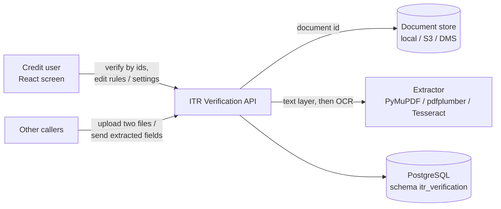

# ITR Verification — Design

Checks a customer's Income Tax Return against the vendor's copy. The credit user names (or uploads) the customer's
**Input ITR** and the vendor's **Output ITR**, optionally with the loan application's PAN / assessment year / GTI and
the vendor's final status; the agent reads both documents, compares them field by field and returns a weighted match
score, a decision (`ACCEPT` / `REVIEW` / `REJECT`) and severity-tagged mismatches. **No model decides anything**:
text comes from the PDF text layer or Tesseract OCR, fields from configured regex patterns, and the decision from
weighted rules and thresholds kept in the database and edited from the Rules Config screen.

| | |
|---|---|
| Backend code | `backend/agents/itr_verification/` |
| Frontend (React) | `frontend/src/agents/itr_verification/` |
| API base | `/api/v1/credit/itr-verification` (router prefix `/credit/itr-verification`; `backend/main.py` adds `/api/v1` through `agents/registry.py`) |
| Database | PostgreSQL `agentic_LOS`, schema `itr_verification` (one schema per agent; `shared/config/agent_databases.yaml`) |
| Rules in force | tables `rule_configs` and `system_settings` in the agent's schema, seeded once from `conf/rules.yaml`; not a `scripts/rules.py` rule set |

---

## 1. Context



* **Authentication**: every route sits behind the LOS JWT (`shared/security/auth.require_jwt`, applied when
  `main.py` mounts the router). The agent has **no scopes or permissions of its own**: any valid token may verify,
  read results, and change rules and settings.
* **Who changed a rule**: `updated_by` is taken from the request body (defaults `api` / `frontend`), not from the
  token's subject.
* **No model**: no language model is called; the decision is the rule engine's alone.

## 2. Layout

```
agents/itr_verification/
├── api.py                 HTTP only: routes -> service; 400 / 404 / 500 mapping (500 names the step, never details)
├── service.py             ITRVerificationService: verify uploads / by ids / fields, persist the result, rules and
│                          settings upsert (the policy in force reloads after each change); build_service() wiring
├── schemas.py             Pydantic request / response models (VerifyByIdsRequest, VerificationResponse, ...)
├── config.py              ITR_VERIFICATION_* env settings; loads conf/rules.yaml and conf/documents.yaml
├── repository.py          ITRRepository protocol + PostgresITRRepository (shared.db.pg, agent key itr_verification);
│                          applies migrations and seeds empty rule / setting tables on first use
├── rules/
│   ├── engine.py          compare_documents(): per-field results, weighted score, decision, mismatches (pure)
│   └── policy.py          Policy: conf defaults with the database rows on top; rule merge; setting (de)serialisation
├── extractors/
│   └── document_extractor.py  PDF text layer -> PyMuPDF OCR -> pdfplumber -> pdf2image + Tesseract; regex fields
├── storage/
│   ├── base.py            DocumentResolver interface, DocumentNotFound
│   ├── local.py s3.py dms.py   the three document stores behind it
├── db/schema.py           MIGRATIONS (append-only; unqualified SQL lands in schema itr_verification)
├── conf/
│   ├── rules.yaml         default comparison rules, application rules, decision settings (seeded into the DB)
│   └── documents.yaml     file types, max size, OCR settings, extracted fields and their regex patterns, storage
└── tests/                 rules, service (fakes), extraction / storage, API smoke test, repository on test Postgres
```

`README.md` in this folder still lists a `frontend/` subfolder; the UI actually lives in `frontend/` (`npx vitest run --project itr_verification`).

## 3. Flow of one verification

ITR verification keeps no case or status: each call is one run, stored in `verification_results`.

1. **Get the two documents**: `/verify` takes two uploads (type from `supported_file_types`, at most
   `max_file_size_mb` = 15 MB, else 400); `/verify/by-ids` resolves two ids in the configured store (404 when absent;
   S3 / DMS downloads go to a temp file deleted after use); `/verify/fields` skips extraction.
2. **Extract** (`extractors/`): digital text first, OCR only for pages without text; fields `applicant_name`, `pan`,
   `assessment_year`, `acknowledgement_number`, `total_income`, `gti`, `form_number`, `filing_date`, `status` by the
   first matching pattern in `field_patterns`. PAN is upper-cased, assessment year normalised to `YYYY-YY`.
3. **Judge** (`rules/engine.py`) with the policy in force (section 4).
4. **Persist** the run (best effort: a database failure is logged and never fails the verification); the answer
   carries its `run_id` when stored.

## 4. The rules

**Comparison rules** (Input ITR vs Output ITR; defaults from `conf/rules.yaml`, editable in `rule_configs`):

| Field | Match type | Weight | Severity on mismatch |
|---|---|---|---|
| `pan` | exact | 25 | critical |
| `assessment_year` | normalized | 20 | critical |
| `total_income` | numeric_tolerance (0 %) | 25 | high |
| `acknowledgement_number` | exact | 20 | critical |
| `applicant_name` | fuzzy (similarity ≥ 0.85) | 5 | medium |
| `form_number` | exact | 2 | low |
| `status` (taxpayer status) | exact | 3 | high |

Both sides missing counts as a match; one side missing as a mismatch.

**Application rules** (each loan-application value checked against **both** documents separately, as
`application_<key>_vs_<side>_document`; a missing value is reported `NOT VERIFIED`):

| Application value | Document field | Match type | Weight | Severity |
|---|---|---|---|---|
| `pan_number` | `pan` | exact | 5 | critical |
| `assessment_year` | `assessment_year` | normalized | 5 | critical |
| `gti_income` | `gti` (falls back to total income) | numeric (0 %) | 5 | high |

**Vendor final status**: matched case-insensitively against `FINAL_STATUS_APPROVED_VALUES` /
`FINAL_STATUS_REJECTED_VALUES`; a missing or unknown status follows `FINAL_STATUS_UNKNOWN_BEHAVIOUR`
(`reject` / `review` / `ignore`; default `review`).

## 5. The decision

* `overall_score` = earned weight / total weight × 100.
* Score ≥ `ACCEPT_THRESHOLD` (90) → `ACCEPT`; ≥ `REVIEW_THRESHOLD` (70) → `REVIEW`; else `REJECT`.
* Overrides, in order:
  1. a critical application mismatch with `CRITICAL_APPLICATION_MISMATCH_FORCES_REJECT` (default false) → `REJECT`;
  2. vendor status REJECTED with `VENDOR_REJECTION_FORCES_REJECT` (default true), or unknown status with behaviour
     `reject` → `REJECT`;
  3. unknown status with behaviour `review` → at most `REVIEW`;
  4. any critical failure with `CRITICAL_BLOCKS_ACCEPT` (default true) → at most `REVIEW`.
* The answer lists `field_results`, `mismatches`, `critical_failures` (vendor status first when critical) and a
  one-line `summary`. `FUZZY_NAME_THRESHOLD` (0.85) is the default similarity for name matching.

**Policy in force** (`rules/policy.py`, `service.reload_policy`): conf defaults, then the database rows on top
(stored comparison rules replace the default list, stored application rules the default mapping, each stored
setting its default). Loaded on first use and reloaded after every rule / setting change or `POST /rules/reload`.
If the database cannot be read, the policy already in force (the conf defaults before the first load) stays and a
warning is logged; `/rules/reload` instead answers 500.

## 6. Data model (schema `itr_verification`)

| Table | Holds |
|---|---|
| `rule_configs` | comparison and application rules (unique `category, field`): enabled, weight, match type, tolerance, severity, document field, label, who / when updated |
| `system_settings` | thresholds and vendor-status policies: `setting_key` → text value + `value_type` (`string` / `number` / `boolean` / `json`) |
| `verification_results` | every run: `run_id`, document ids, application values, decision, score, summary, vendor status, critical failures, mismatches, field results, extracted fields (JSONB) |
| `agent_logs` | WARNING+ application logs (shared) |
| `api_responses` | every POST / PUT response of `/api/v1/credit/itr-verification` (shared) |

Migrations `0001` (the three ITR tables), `0002` (`agent_logs`), `0003` (`api_responses`) in `db/schema.py`, applied
by the repository on first use; a change is always a new migration. Seeding fills only **empty** rule / setting
tables (`updated_by = system_seed`); after that the database copy is in force. `verification_results` keeps the
application PAN and applicant name as sent.

## 7. API

| Method | Path (under `/api/v1/credit/itr-verification`) | Permission | Purpose |
|---|---|---|---|
| GET | `/` | LOS JWT | the list of routes |
| GET | `/health` | LOS JWT | status, thresholds in force, supported types, `database` connected / error kind |
| GET | `/config` | LOS JWT | comparison / application rules and thresholds in force |
| POST | `/verify` | LOS JWT | multipart `input_doc` + `output_doc` (`?return_raw=` adds the OCR text) |
| POST | `/verify/by-ids` | LOS JWT | two document ids in the configured store + optional `pan_number`, `assessment_year`, `gti_income`, `applicant_name`, `address`, `final_status` |
| POST | `/verify/fields` | LOS JWT | `{"input_fields": {...}, "output_fields": {...}}` (no documents, no application data) |
| GET | `/rules?category=` | LOS JWT | rule configs (`comparison` / `application`) |
| PUT | `/rules` | LOS JWT | upsert one rule (omitted attributes keep their stored value) |
| PUT | `/rules/bulk` | LOS JWT | bulk upsert (Rules Config "Save All") |
| POST | `/rules/reload` | LOS JWT | re-read rules and settings from the database |
| GET | `/settings` | LOS JWT | system settings |
| PUT | `/settings` | LOS JWT | upsert one setting (`value_type` kept from the stored row when omitted) |
| PUT | `/settings/bulk` | LOS JWT | bulk upsert settings |
| GET | `/results` | LOS JWT | stored runs, newest first (`limit` 1–500, `offset`, `decision`, `pan_number`) |
| GET | `/results/{run_id}` | LOS JWT | one stored run (404 when absent) |

Errors are FastAPI's `{"detail": ...}`: 400 for a rejected document or bad input, 404 for an unknown document or run,
500 naming the failed step and the error's kind (details only in the log).

## 8. Frontend

`frontend/src/agents/itr_verification/` — React 18 + TypeScript, Vite 5, Tailwind CSS, `lucide-react` icons, `clsx`.

* **App.tsx** — two tabs:
  * **Verify**: Input / Output ITR document ids and the application values (PAN, assessment year, GTI, final status),
    sent to `/verify/by-ids`; shows `DecisionBadge` and `ScoreBar` (decision and score), `InsightsPanel` ("Insights &
    Recommendations"), `MismatchList` and `FieldComparisonTable` (each field, both values, score, severity). The
    screen does not use the upload route.
  * **Rules Config** (`RulesConfigTab`): comparison rules, application rules and settings sections; Save All calls
    `/rules/bulk` then `/settings/bulk`.
* **SettingsModal**: the API base URL (kept in `localStorage`) with a `/health` check. `SeverityBadge` tags severities.
* `src/api/client.ts`: API base `${VITE_LOS_API_ORIGIN}/api/v1/credit/itr-verification` (same origin when unset); the
  LOS JWT is sent as a Bearer token from `localStorage["los_access_token"]` when present.

Run: from `frontend/`, `npm install && npm run dev` → http://localhost:5190/itr_verification (the one console app;
this screen is one tab of the console). `ITR_API` points this agent's API base route at another backend
(default `LOS_API`, `http://127.0.0.1:8010`). Build: `npm run build` → `frontend/dist/` (one chunk per agent).
Lists that can grow are paginated with the shared `Pagination` (`frontend/src/shared/components`).

## 9. Configuration and operations

* Database: `LOS_AGENTIC_DSN` (schema `itr_verification`); `ITR_VERIFICATION_DSN` optionally names a database of the
  agent's own. Resolved by `shared/db/core.py`.
* Document store for `/verify/by-ids`: `ITR_VERIFICATION_DOCUMENT_SOURCE` (`local` / `s3` / `dms`; default from
  `conf/documents.yaml`), `ITR_VERIFICATION_LOCAL_INPUT_DIR`, `ITR_VERIFICATION_LOCAL_OUTPUT_DIR` (ids cannot leave
  them), `ITR_VERIFICATION_S3_BUCKET`, `ITR_VERIFICATION_S3_REGION` (credentials from the standard AWS chain),
  `ITR_VERIFICATION_DMS_BASE_URL`, `ITR_VERIFICATION_DMS_API_KEY`, `ITR_VERIFICATION_DMS_TIMEOUT_SECONDS`,
  `ITR_VERIFICATION_TEMP_DIR`.
* Conf files: `conf/rules.yaml` (seed of rules and settings), `conf/documents.yaml` (types, size, OCR language / DPI,
  fallback pages, field patterns). Quote YES / NO-like strings in the yaml.
* Rule changes: through the Rules Config screen or `/rules` and `/settings` — **not** `scripts/rules.py`. Editing
  `conf/rules.yaml` affects only an empty database.
* System packages for real documents: Tesseract OCR (images, scanned pages) and Poppler (pdf2image fallback).
* No demo mode, no sample data and no language model.

## 10. Tests

`python -m pytest -q agents/itr_verification/tests` (from `backend/`) covers the rule engine, the service (fake
repository and resolver), extraction and storage, an API smoke test, and the Postgres repository
(`test_repository_pg.py`, on a throwaway database of the test PostgreSQL server; skipped without `psycopg`). No test
reads a real document or a configured database. Frontend: no test script in `package.json`.
