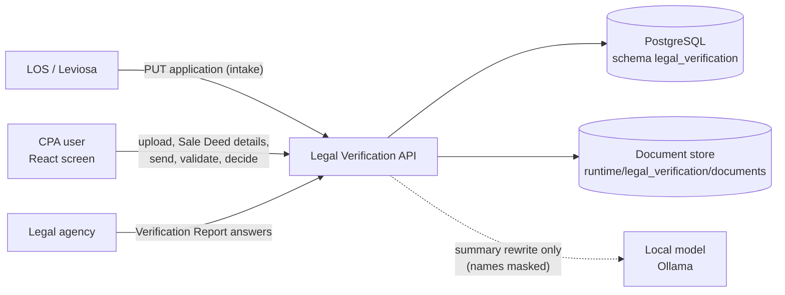
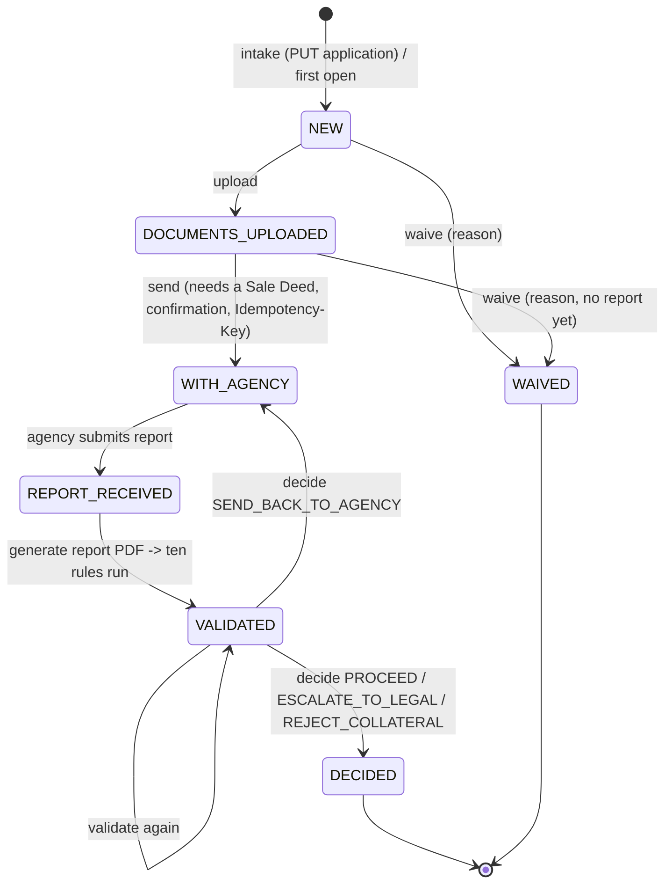

# Legal Verification — Design

The legal check of a loan's collateral property. The CPA (credit processing) user receives an application from the
LOS, records the Sale Deed's details, sends the case to an empanelled legal agency, receives the agency's
Verification Report, runs ten deterministic rules and records a decision. **No model decides anything**: the rules
recommend, the CPA decides, and the local language model only rewrites the rules' summary in plain words.

| | |
|---|---|
| Backend code | `backend/agents/legal_verification/` |
| Frontend (React) | `frontend/src/agents/legal_verification/` |
| API base | `/api/v1/credit/legal-verification` (mounted by `backend/main.py` through `agents/registry.py`) |
| Database | PostgreSQL `los_agentic`, schema `legal_verification` (one schema per agent; `shared/config/agent_databases.yaml`) |
| Rules in force | rule set `legal_verification_policy` in the database; `conf/legal_verification.yaml` is the source of a version |

---

## 1. Context



* **Authentication**: every route sits behind the LOS JWT (`shared/security/auth.require_jwt`). What a caller may do
  comes from the token's scopes (`conf access.scopes`); which applications they may open comes from their branches
  (`access.branches`, `"*"` = all). An application the caller may not see answers exactly like one that does not
  exist (404) — nothing leaks across branches.
* **No OCR**: the CPA enters the Sale Deed's details from the uploaded document. The agency reads the deed too; the
  rules compare the sources.

## 2. Layout

```
agents/legal_verification/
├── api/routes.py          HTTP only: request models, routes -> services (no SQL, no rules)
├── services/
│   ├── workflow.py        the business actions: intake, save vendor, waive, send, submit report, generate report,
│   │                      validate, decide, edit application -- each permission-checked, state-checked, audited
│   ├── cases.py           lookups scoped to the caller; the WORKSPACE view; evidence for the rules; PAN masking
│   ├── documents.py       upload (type / size / signature / hash), preview, Sale Deed entry and corrections
│   ├── agency_report.py   the agency's report as a PDF built only from its answers + the analysis; attached to the case
│   ├── summary.py         the run's summary in points; optional background rewrite by the local model, validated
│   ├── report.py          the downloadable Legal Collateral Verification Report (PDF)
│   ├── sample.py          "Fill sample" (demo mode only): realistic values consistent with the case
│   ├── access.py          Caller (user, permissions, branches) from the verified token
│   ├── audit.py errors.py audit rows and the one error type (ServiceError -> the shared error envelope)
├── rules/
│   ├── engine.py          the ten rules (pure functions over an Evidence object) and the recommendation
│   └── fold.py            name / date / PIN normalisation used by the rules
├── db/
│   ├── schema.py          MIGRATIONS (append-only, run once each, in order)
│   └── database.py        connections for this agent's schema (shared.db)
├── conf/
│   ├── legal_verification.yaml           policy: access, documents, agencies, property types, periods, the agency
│   │                                     report form, rule severities / actions, recommendation, decisions, report
│   ├── legal_verification_wording.yaml   every sentence and label (API messages, rules, screen, PDFs)
│   └── legal_verification_demo.yaml      synthetic applications for the demo
├── demo_data/seed.py      loads the demo applications (demo mode; POST /demo/reset)
└── tests/                 rules, workflow and API tests
```

The code holds logic only. Thresholds, periods, labels, severities and permissions are configuration.

## 3. Case lifecycle



Guards enforced by the API (not only the screen):

* A `DECIDED` or `WAIVED` case takes no further action (409 `ALREADY_DECIDED` / `ALREADY_WAIVED`).
* `send` needs a Sale Deed on file (409 `NO_SALE_DEED`) and an enabled agency (422 `UNKNOWN_AGENCY`); the same
  Idempotency-Key twice is one sending.
* `validate` needs the deed and the agency report (409 `NOTHING_TO_VALIDATE` / `NO_AGENCY_REPORT`).
* `decide` needs a validation of the current evidence (409 `NOT_VALIDATED` / `RULES_PENDING`); remarks are required
  for the decisions listed in `decision.remarks_required_for`; `PROCEED` only for the recommendations in
  `decision.proceed_allowed_for` (409 `PROCEED_BLOCKED`).
* `waive` needs a reason and is refused once a report is in (409 `REPORT_ALREADY_IN`).

## 4. The ten rules

Each rule returns **PASS** (green), **REVIEW** (amber: evidence missing or uncertain — never a pass by default) or
**FAIL** (red: a mismatch), with the values it compared **by source** (APPLICATION, SALE_DEED, CORRECTED, AGENCY,
AGENT), what is missing, and the next action.

| # | Rule | Severity on FAIL | Action |
|---|---|---|---|
| R1 | Owner details match | CRITICAL | Verify owner identity |
| R2 | Sale Deed looks consistent | HIGH | Check the Sale Deed original |
| R3 | Property address matches | HIGH | Verify property address |
| R4 | Ownership history (title chain over the search period) | HIGH | Request title chain |
| R5 | Registration details | HIGH | Verify registration |
| R6 | Loan, mortgage and other claims (encumbrance, CERSAI) | CRITICAL | Clear encumbrance |
| R7 | Required documents and search period | MEDIUM | Request missing documents |
| R8 | Property-specific legal checks (by property type) | MEDIUM | Complete legal checks |
| R9 | Agency report cross-check | HIGH | Clarify with agency |
| R10 | Overall risk and next action | — | sums up R1–R9 |

**Recommendation (R10)**: `ESCALATE` when a failed rule is CRITICAL (`recommendation.escalate_on_severity`) or at
least `recommendation.escalate_min_failed` rules failed; `REVIEW_REQUIRED` when anything failed or needs review;
otherwise `CLEAR_FOR_REVIEW`. The title search and encumbrance periods (13 years) come from `title_search.years` /
`encumbrance.years`.

Every run stores its results, the recommendation, a hash of the facts it saw and the hash of the policy version it ran
under (`rule_set_hash`), so a decision can always be traced to the exact rules in force.

## 5. Summary and AI

`services/summary.py` writes the run's summary as points in a fixed order (red flags, amber items, agency vs
documents, passes, next action) from the rule results — always available at once. If `ai_summary.enabled`, the local
model (Ollama) rewrites those points in the background with every person's name masked. Its answer is checked line by
line (same number of points, same order, no figure its point does not hold, no banned words such as "approved" /
"clear title", no "passed" on a point that did not pass). Refused, slow or unavailable → the rules' points stand;
`source` says `ai` / `refused` / `unavailable`.

## 6. Data model (schema `legal_verification`)

| Table | Holds |
|---|---|
| `legal_verification_applications` | what the LOS sent: branch, product, amount, applicant, property type / address / PIN, owners, `details` (JSONB, PANs masked), `is_demo` |
| `legal_verification_cases` | one verification per application: status, selected / sent agency, idempotency key, waiver, decision |
| `legal_verification_documents` | uploaded files: kind, reference, type, SHA-256, size, pages, metadata, entered Sale Deed fields |
| `legal_verification_corrections` | a changed Sale Deed value: before, after, reason, who, when |
| `legal_verification_agency_reports` | each submitted report: answers (JSONB), the generated PDF document, its analysis |
| `legal_verification_runs` | each validation: rules, overview, recommendation, facts hash, `rule_set_hash` |
| `legal_verification_summaries` | the summary text of a run and its source |
| `legal_verification_audit` | append-only event trail (ids, statuses, field names — never document content) |
| `rule_sets`, `rule_set_active`, `rule_set_changes` | policy versions, the one in force, who changed it and why |
| `api_responses`, `agent_logs` | every API response (append-only); WARNING+ logs |

Migrations `0001`–`0007` in `db/schema.py`; a change is always a new migration, never an edit of an old one.

Files are stored under `storage.documents_dir` (default `backend/runtime/legal_verification/documents`); the database
keeps the reference and hash. Uploads are checked for allowed type, file signature (magic bytes) and the size limit
(`documents.max_mb`, 25 MB); PDFs from editing tools or modified long after creation are flagged for R2.

## 7. API

| Method | Path (under `/api/v1/credit/legal-verification`) | Permission | Purpose |
|---|---|---|---|
| GET | `/config` | view | labels, form, agencies, decisions, rules, UI switches for the screen |
| GET | `/applications?q=` | view | the worklist (caller's branches) |
| PUT | `/applications/{id}` | manage_applications | intake from the LOS |
| GET | `/applications/{id}` | view | the workspace |
| PUT | `/applications/{id}/details` | edit_application | edit application details (PANs masked) |
| POST | `/applications/{id}/documents` | upload | upload a document (multipart `kind`, `file`) |
| GET | `/documents/{id}/file` | view | preview a stored file |
| POST | `/applications/{id}/sale-deed` | correct_extraction | enter / edit the Sale Deed details (changes need a reason) |
| POST | `/documents/{id}/corrections` | correct_extraction | correct one Sale Deed field |
| GET | `/applications/{id}/sample?part=` | (demo only) | "Fill sample" values |
| POST | `/applications/{id}/vendor` | initiate | save the chosen agency |
| POST | `/applications/{id}/waive` | waive | waive the verification (reason) |
| POST | `/applications/{id}/send` | initiate | send to the agency (confirmation + Idempotency-Key) |
| GET / POST | `/applications/{id}/agency-report` | view / submit_agency_report | read / submit the agency report |
| POST | `/applications/{id}/agency-report/generate` | submit_agency_report or validate | build the report PDF, run the rules |
| POST | `/applications/{id}/validate` | validate | run the ten rules |
| GET | `/applications/{id}/summary` | view | the latest run's summary |
| POST | `/applications/{id}/decision` | decide | record the CPA's decision |
| GET | `/applications/{id}/report` | download_report | the PDF report |
| POST | `/demo/reset` | reset_demo (demo only) | reload the synthetic applications |

Errors use the shared envelope `{"error": {"code", "message", "details"}}` with codes from the wording file.

**Scopes → permissions** (`conf access.scopes`): `los.credit.underwrite` (CPA: everything except intake and
submitting agency reports), `los.legal.agency` (view, submit agency report), `los.write` (all), `los.read` (view,
download report).

## 8. Frontend

`frontend/src/agents/legal_verification/` — React 18 + TypeScript + Mantine, built with Vite.

* **WorklistPage**: the applications the user may open, with search.
* **CasePage**: application details (editable fields from `application_edit`), documents and upload, Sale Deed entry
  with corrections, vendor / send / waive, the agency report form (drawn from `GET /config` → `form`), the
  verification report (ten rules with comparisons by source), the summary and the decision.
* All labels and options come from `GET /config`; the screen holds no business rule. API calls go through
  `src/services/api.ts` (same-origin `/api`, proxied to the backend in development by `vite.config.ts`).

Run: from `frontend/`, `npm install && npm run dev` → http://localhost:5190/legal_verification (the one console app;
this screen is one tab of the console). `LGV_API` points this agent's API base route at another backend
(default `LOS_API`, `http://127.0.0.1:8010`). Build: `npm run build` → `frontend/dist/` (one chunk per agent).
Lists that can grow are paginated with the shared `Pagination` (`frontend/src/shared/components`).

## 9. Configuration and operations

* Settings: `backend/.env` (see `.env.example`) — the database DSN (`LOS_AGENTIC_DSN`), JWT settings, `ENVIRONMENT`.
* Policy changes: edit `conf/legal_verification.yaml`, then `python scripts/rules.py import legal_verification_policy
  --by "<name>" --note "<why>" --activate`. The new version is in force within `rules.cache_seconds`, no restart.
* Demo mode (`demo_mode: true`) enables synthetic applications, "Fill sample", the reset button and an automatic
  agency reply after sending. It must be off in production.
* Database schema: created / upgraded by the shared migration runner (`scripts/setup_agent_databases.py`).

## 10. Tests

`python -m pytest -q agents/legal_verification/tests` (from `backend/`) covers the rules, the workflow guards and the
API. Frontend: `npm test` (Vitest) in `frontend/` (`npx vitest run --project legal_verification`).
