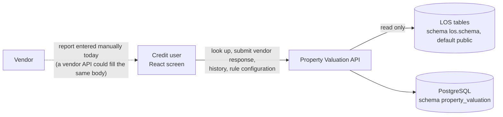
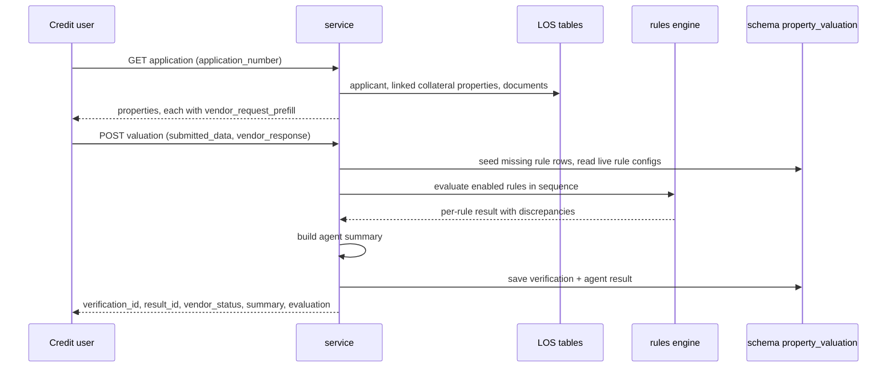

# Property Valuation — Design

Checks a vendor's property inspection / valuation report against the LOS property record. The credit user looks up a
loan application, picks one of its collateral properties, checks what was sent to the vendor (prefilled from the LOS),
enters the vendor's response, and the agent runs up to 22 configurable rules and stores the visit and a compact
result. **No model is involved**: the rules decide which discrepancies are raised, and the agent status (`HIGH_RISK`
/ `REVIEW` / `CLEAR`) is a summary of the configured rule severities, not a credit decision.

| | |
|---|---|
| Backend code | `backend/agents/property_valuation/` |
| Frontend (React) | `frontend/src/agents/property_valuation/` |
| API base | `/api/v1/credit/property-valuation` (router's own prefix; mounted by `backend/main.py` through `agents/registry.py`) |
| Database | PostgreSQL `agentic_LOS`, schema `property_valuation` (`shared/config/agent_databases.yaml`; own DSN `PROPERTY_VALUATION_DSN` optional) |
| Rules in force | table `property_valuation_rule_configs` (live, edited from the screen); `conf/rules.yaml` is the seed for rules with no row yet. Not in the shared `rule_store`. |

---

## 1. Context



* **Authentication**: every route sits behind the LOS JWT — `main.py` mounts the router with
  `dependencies=[Depends(require_jwt)]`. The router itself checks no scopes or branches: any valid LOS token may read
  applications, submit valuations and change the rule configuration.
* **Database session**: `shared.db.sqla.session_dependency("property_valuation")`; the session's search_path is the
  agent's schema. The LOS tables are read with schema-qualified SQL (`los.schema` in `conf/settings.yaml`).
* **No OCR, no model**: values come from the LOS record and the vendor response as entered.

## 2. Layout

```
agents/property_valuation/
├── api.py              HTTP only: the router, error mapping (400 / 404 / 500), repository / service dependencies
├── service.py          the use cases: application lookup + prefill, submit valuation, history, results, rules
├── repository.py       Protocol + PostgreSQL repository (LOS reads, rule seeding, saving a run, history)
├── schemas.py          request bodies: ValuationSubmission, RuleConfigUpdate
├── config.py           settings from conf/ (cached; PROPERTY_VALUATION_CONF_DIR overrides the folder)
├── rules/
│   ├── engine.py       the 22 rule checks and evaluate_property_records (enabled rules, by sequence)
│   ├── inputs.py       LOS / vendor fields -> rule labels; the vendor-request prefill
│   └── summary.py      vendor status normalisation; the agent summary (status, counts, insights, actions)
├── db/
│   ├── schema.py       MIGRATIONS (append-only, run once each, in order)
│   └── models.py       ORM models of the three agent tables
├── conf/
│   ├── rules.yaml      the rule catalogue: id, name, severity, enabled, sequence, field labels, settings
│   └── settings.yaml   engine comparison settings, agent version, default vendor name, LOS schema
├── README.md           endpoints, rules, field mapping
└── tests/              rules, service (fake repository), API smoke and schema tests
```

The code holds logic only. Severities, thresholds, field labels and which rules run are configuration.

## 3. Valuation flow

There is no case state machine: each submission is a stored vendor visit plus one agent result. Visits are typed
`INITIAL_VISIT` or `REVISIT` and are never overwritten.



Guards: the body's `collateral_property_id` must equal the URL's (400); an unknown application, or a property that does
not belong to it, is 404. The vendor's `Final Status` is stored upper-cased (`POSITIVE` / `NEGATIVE` / `REFER`; other
values kept as sent).

## 4. The rules

Seed values from `conf/rules.yaml`; after first use the table rows are the live configuration (enabled, sequence,
severity, fields and settings can be changed per rule). A triggered rule raises discrepancies (field, LOS value,
vendor value, reason) and a recommended action.

| Rule | Id | What it checks | Seed severity | Seed state |
|---|---|---|---|---|
| RULE_1 | PROP-012 | Registration Completeness | MINOR | disabled |
| RULE_2 | PROP-013 | Owner Name Consistency | CRITICAL | enabled |
| RULE_3 | PROP-014 | Applicant Versus Owner Comparison | MAJOR | enabled |
| RULE_4 | PROP-015 | Deed And Registration Consistency | MAJOR | enabled |
| RULE_5 | PROP-016 | Sanctioned Plan Evidence | MAJOR | enabled |
| RULE_6 | PROP-020 | Address Consistency | MAJOR | enabled |
| RULE_7 | PROP-021 | Postal-Location Consistency | MAJOR | disabled |
| RULE_8 | PROP-022 | Unit Identification | MAJOR | enabled |
| RULE_9 | PROP-023 | Owner/Property Record Linkage | MINOR | disabled |
| RULE_10 | PROP-024 | Project/Building Consistency | MINOR | enabled |
| RULE_11 | PROP-030 | Property Type And Usage Consistency | MAJOR | enabled |
| RULE_12 | PROP-031 | Property Nature Consistency | MAJOR | enabled |
| RULE_13 | PROP-032 | Occupancy Consistency | MAJOR | enabled |
| RULE_14 | PROP-036 | Sanctioned-Plan Consistency | MAJOR | enabled |
| RULE_15 | PROP-037 | Property Age Validation | MINOR | enabled |
| RULE_16 | PROP-040 | Area Input Validation | MAJOR | enabled |
| RULE_17 | PROP-041 | Carpet-Area Consistency | MAJOR | disabled |
| RULE_18 | PROP-042 | Adopted-Area Validation | MAJOR | enabled |
| RULE_19 | PROP-043 | Rate Validation | MAJOR | enabled |
| RULE_20 | PROP-044 | Market-Value Reconciliation (`tolerance_percent` 5.0) | CRITICAL | enabled |
| RULE_21 | PROP-045 | Value-to-be-Considered Review (`tolerance_percent` 5.0) | CRITICAL | enabled |
| RULE_22 | PROP-046 | Valuation Date and Remarks | MINOR | enabled |

Four rules start disabled because the data they compare is not available yet: RULE_1 (registration number / date /
registered-at / transaction type are in neither source), RULE_7 (no separate vendor pincode / city / state /
landmark), RULE_9 (Reference ID and Asset Id not in the LOS schema), RULE_17 (the vendor returns one carpet area).
RULE_5 and RULE_14 overlap (sanctioned plan). Engine settings (`conf/settings.yaml engine`): case-insensitive, trimmed
text comparison; `stop_on_first_failure: false`; disabled rules are not in the response.

## 5. Agent status

`rules/summary.py` turns one evaluation into the stored result:

* **Severity counts**: each triggered rule adds its discrepancy count (at least 1) to its severity
  (CRITICAL / MAJOR / MINOR).
* **agent_status**: `HIGH_RISK` if any CRITICAL issue; else `REVIEW` if any rule triggered; else `CLEAR`.
* **key_insights**: one per discrepancy (rule, severity, field, issue, LOS value, vendor value).
* **risk_factors**: issue count per rule id. **recommended_actions**: the distinct actions of the triggered rules.
* Totals: rules checked, passed (checked − triggered), triggered.

A change to the rule configuration affects later runs only; stored results stay as they were.

## 6. Data model (schema `property_valuation`)

| Table | Holds |
|---|---|
| `property_valuation_verifications` | one row per vendor visit / revisit: application, property, vendor name, visit type, vendor status, `submitted_data` and `vendor_response` (JSONB), verified / created time |
| `property_valuation_agent_results` | one row per agent run: link to its verification, agent version, vendor and agent status, rule and severity counts, insights, risk factors, actions (JSONB) |
| `property_valuation_rule_configs` | one row per rule: original id, name, description, enabled, sequence, severity, fields and settings (JSONB) |
| `agent_logs` | WARNING+ application logs (shared) |
| `api_responses` | every POST / PUT response (append-only, shared) |

Migrations `0001` (the three agent tables, `IF NOT EXISTS` so older tables are adopted), `0002` (agent_logs), `0003`
(api_responses) in `db/schema.py`; applied by `scripts/setup_agent_databases.py`. Rule rows missing from the table are
inserted from `conf/rules.yaml` on first use; existing rows are never overwritten.

LOS tables read (never written): `loan_applications`, `customers`, `application_participants`,
`individual_applicant_details`, `non_individual_applicant_details`, `primary_applicant_kyc`, `collateral_properties`,
`collateral_property_documents`.

## 7. API

| Method | Path (under `/api/v1/credit/property-valuation`) | Permission | Purpose |
|---|---|---|---|
| GET | `/health` | LOS JWT | `{"status": "ok"}` for the screen's connection check (hidden from the schema) |
| GET | `/applications/{application_number}` | LOS JWT | applicant and linked properties, each with `vendor_request_prefill` |
| POST | `/applications/{application_number}/properties/{property_id}/valuation` | LOS JWT | save a vendor visit, run the rules, save the agent result |
| GET | `/applications/{application_number}/history?collateral_property_id=` | LOS JWT | vendor visits and agent results |
| GET | `/results/{application_number}` | LOS JWT | saved agent summaries |
| GET | `/rules` | LOS JWT | the live rule configuration |
| PUT | `/rules/{rule_key}` | LOS JWT | change enabled, sequence (≥ 1), severity, settings, fields, description |

Errors: 400 body / URL property mismatch; 404 unknown application, foreign property or unknown rule; 500 with a fixed
message when the database or the rules fail (details only in the server log). The submission body forbids unknown
fields; `verification_type` is `INITIAL_VISIT` or `REVISIT`.

## 8. Frontend

`frontend/src/agents/property_valuation/` — React 18 + TypeScript, built with Vite; no UI library (`src/styles.css`).

* **App.tsx**: header, the three tabs, toast.
* **ValuationTab**: fetch an application, pick a property, the outgoing form (prefilled), the vendor response form,
  "Save vendor response & run agent".
* **ResultView**: the assessment — counts, banner, rule-wise evaluation, side-by-side LOS / vendor values,
  discrepancies, recommended actions.
* **RulesTab**: per rule: enabled, severity, order, settings and field mapping (JSON); Save writes it to the database.
* **HistoryTab**: an application's vendor visits and agent results.
* **FormField**: one field of either form. `src/config/forms.ts` defines the outgoing and vendor fields and
  dropdowns; `src/utils/result.ts` holds the screen's pure logic (severity bands, rule order, comparison rows, banner).
* `src/services/api.ts` calls `/health`, `/applications/{no}`, the valuation POST, `/rules`, `PUT /rules/{key}` and
  `/applications/{no}/history` on the same origin (it does not call `/results`); the app sends no token itself.

Run: from `frontend/`, `npm install && npm run dev` → http://localhost:5190/property_valuation (the one console app;
this screen is one tab of the console). `PRV_API` points this agent's API base route at another backend
(default `LOS_API`, `http://127.0.0.1:8010`). Build: `npm run build` → `frontend/dist/` (one chunk per agent).
Lists that can grow are paginated with the shared `Pagination` (`frontend/src/shared/components`).

## 9. Configuration and operations

* Settings: `backend/.env` (see `.env.example`) — `LOS_AGENTIC_DSN` (or `PROPERTY_VALUATION_DSN` for a database of
  its own), JWT settings.
* `PROPERTY_VALUATION_CONF_DIR`: a folder with `rules.yaml` / `settings.yaml` replacing `conf/`. Both files are
  validated at load (every rule needs `original_id`, `name`, `sequence`; `agent.agent_version`,
  `agent.default_vendor_name` and an identifier `los.schema` are required).
* Rule changes: from the Rule configuration tab (`PUT /rules/{rule_key}`). Editing `conf/rules.yaml` only affects rules
  that have no row yet. This agent's rules are not managed by `scripts/rules.py`.
* No demo mode, no demo data and no `is_demo` column.
* Database schema: created / upgraded by `scripts/setup_agent_databases.py`.

## 10. Tests

`python -m pytest agents/property_valuation/tests -q -p no:cacheprovider` (from `backend/`): rules
(`test_rules.py`), service with a fake repository (`test_service.py`), API smoke with dependencies overridden
(`test_api.py`) and migrations (`test_schema.py`). No database, no network, synthetic data. Frontend: `npm test`
(Vitest, fetch mocked) in `frontend/` (`npx vitest run --project property_valuation`).
