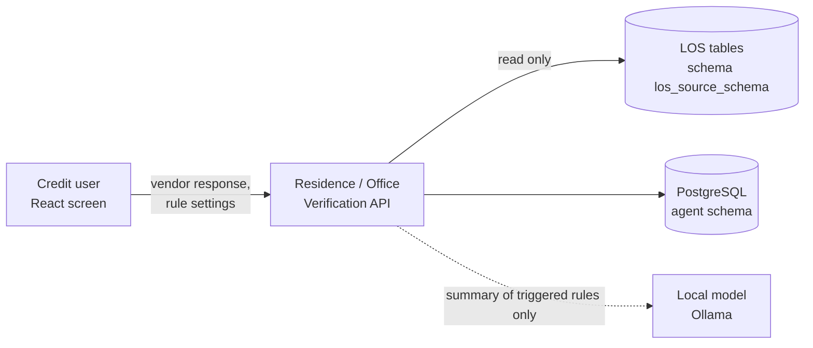

# Residence / Office Verification — Design

The check of a field-verification vendor's visit report (a residence or an office visit) against the address the
applicant declared in the LOS. The credit user enters the vendor's response by hand (there is no vendor API), the
agent picks the participant's one declared address from the LOS tables, runs ten deterministic rules and stores the
run. **No model decides anything**: the rules give the recommendation (PASS / PENDING / REVIEW / REFER), and the local
language model only writes a short bullet summary of the rules that raised an issue.

| | |
|---|---|
| Backend code | `backend/agents/residence_office_verification/` |
| Frontend (React) | `frontend/src/agents/residence_office_verification/` |
| API base | `/api/v1/credit/residence-office-verification` (router prefix `/credit/residence-office-verification`; `agents/registry.py` adds `/api/v1`) |
| Database | PostgreSQL `agentic_LOS`, schema `office_residence_verification` (one schema per agent; `shared/config/agent_databases.yaml`) |
| Rules in force | the rows of `residence_rule_configs` / `office_rule_configs` (editable from the screen); `conf/rules.yaml` holds the defaults. Not in the shared `rule_store` |

---

## 1. Context



* **Authentication**: every route sits behind the LOS JWT (`main.py` mounts each agent router with
  `Depends(require_jwt)`). The agent itself has no roles or scopes of its own: any valid token may verify and may
  change the rule settings.
* **LOS data is read, never written**: `loan_applications`, `application_participants`, `customers`,
  `individual_applicant_details`, `applicant_addresses` in schema `los_source_schema` (default `public`).
* **No OCR, no vendor integration**: the vendor response is a JSON object the user fills in.

## 2. Layout

```
agents/residence_office_verification/
├── __init__.py        exports router and ResidenceVerificationService
├── api.py             HTTP only: three routes -> service; maps errors to 400 / 404 / 409 / 422 / 503
├── service.py         use cases: verify (application, participant, the one address, rules, store, summary),
│                      list / bulk-update rule settings; VerificationError
├── repository.py      RuleRepository protocol + PostgresRepository (LOS reads, rule configs, results); migrate()
├── schemas.py         Pydantic request models (verification request, rule config bulk update)
├── config.py          Settings from conf/ (rules, criticality order, risk score, address types, AI summary) + env
├── summary.py         the AI summary of the triggered rules (Ollama /api/chat); never fails a run
├── rules/
│   ├── engine.py      the ten rules (pure) and the overall recommendation / criticality / risk score
│   └── address.py     address normalisation and comparison (NFKC, case, punctuation, spaces)
├── db/schema.py       MIGRATIONS (append-only, run once each, in order)
├── conf/
│   ├── rules.yaml     default rules per mode (RESIDENCE / OFFICE), criticality order, risk score switch
│   └── settings.yaml  LOS schema, accepted address types, AI summary (model, timeout, prompts, texts)
├── README.md
└── tests/             rules, service on a fake repository, summary, API smoke test (synthetic data)
```

## 3. Case lifecycle

The agent keeps no case status: each POST is one stored evaluation run. The flow of one run:

1. Find the application (404 `Application ID was not found.`) and the participant under it (404).
2. Pick the participant's address: exactly one row in `applicant_addresses` whose `address_type` is in
   `settings.yaml residence_address_types` (case-insensitive). None → 422, more than one → 409. The declared address
   is `full_address`, else the address parts joined.
3. Load the rule settings for the mode from the database (the `conf/rules.yaml` defaults when the table is empty).
4. Run the ten rules; drop disabled ones; apply the configured rule id, name, criticality and weight.
5. Store the run with snapshots of the application, participant and address; return it with `result_id`.
6. Add the AI summary (not stored): no triggered rule → the all-clear text, no model call; model down or slow → the
   notice text, `ai_summary_source: "unavailable"`.

## 4. The ten rules

Each rule returns **PASS**, **ISSUE**, **PENDING** (missing or unrecognised value — never assumed false) or
**NOT_APPLICABLE**. Vendor keys are matched case-insensitively; Yes / No / true / false / Positive / Negative are read
as booleans. Ids are `RES-0xx` (RESIDENCE) or `OFF-0xx` (OFFICE); defaults from `conf/rules.yaml`:

| Key | Rule | ISSUE when | Criticality | Weight |
|---|---|---|---|---|
| RULE_01 | Vendor verification status | `status` negative / fail / unverified | HIGH | 25 |
| RULE_02 | Neighbour confirmation | `neighbour_check` false | MEDIUM | 10 |
| RULE_03 | Declared address confirmation | `address_confirmed` false | HIGH | 20 |
| RULE_04 | Negative area flag | `negative_area` true | HIGH | 20 |
| RULE_05 | Vendor-reported political link | `political_link` true (vendor flag only, never inferred) | MEDIUM | 10 |
| RULE_06 | Name plate visibility | `name_plate_visible` false | LOW | 5 |
| RULE_07 | Community-dominated area context | `community_dominated` true — context only, no risk contribution | LOW | 0 |
| RULE_08 | Corrected address comparison | `corrected_address` differs from the declared address after normalisation; none given → NOT_APPLICABLE | HIGH | 20 |
| RULE_09 | Vendor final status | `final_status` Rejected; Waived and Pending → PENDING (a waiver is not a pass) | HIGH | 25 |
| RULE_10 | Status and findings consistency | status vs final status contradict, or final Approved while other rules have issues | CRITICAL | 30 |

RULE_10 is **disabled by default for RESIDENCE** and enabled for OFFICE.

## 5. Recommendation

Over the enabled rules (`rules/engine.py`):

* **REFER** — any risk-contributing ISSUE of criticality HIGH or CRITICAL;
* **REVIEW** — any other risk-contributing ISSUE;
* **PENDING** — no such issue, but a rule is PENDING;
* **PASS** — otherwise.

`overall_criticality` is the highest criticality among the risk-contributing issues (else PENDING / NONE). The
optional `risk_score` (`conf/rules.yaml risk_score`, **off** by default; null while off) is the sum of the weights of
the risk-contributing issues, capped at `max` (100). RULE_07 never contributes. The response also carries `summary`,
`rules_evaluated`, `rules_triggered`, `insights` (the ISSUE / PENDING rules) and `rules` (most critical first).

**AI summary** (`summary.py`, `settings.yaml ai_summary`): the model gets only the triggered rules (id, name,
summary, finding) and writes short markdown bullets; `<think>` blocks are stripped. Returned as `ai_summary`,
`ai_summary_source` (`ai` / `rules` / `unavailable` / `off`) and `ai_summary_model`. It explains; it never changes
the recommendation.

## 6. Data model (schema `office_residence_verification`)

| Table | Holds |
|---|---|
| `residence_rule_configs`, `office_rule_configs` | the rule settings per mode: `rule_key` (unique), rule id, name, enabled, criticality, weight |
| `residence_rule_results`, `office_rule_results` | every run: application / participant ids, vendor name, recommendation, criticality, risk score, summary, counts, insights / rules / vendor response (JSONB), declared address, application / participant / address snapshots |
| `agent_logs` | WARNING+ application logs |
| `api_responses` | every POST / PUT response (masked) |

Migrations in `db/schema.py`: `rov-0001` (tables and indexes on application / participant), `rov-0002` (seed the
default rule settings, `ON CONFLICT DO NOTHING`), `common-logs-0001`, `responses-0001`. Applied by
`scripts/setup_agent_databases.py` (or `repository.migrate()`), never at request time. A released migration is never
edited. There is no `is_demo` column and no demo seed.

## 7. API

| Method | Path (under `/api/v1/credit/residence-office-verification`) | Permission | Purpose |
|---|---|---|---|
| POST | `/residence-verification` | LOS JWT | evaluate the vendor response for `verification_type` RESIDENCE / OFFICE; store the run; return it with the AI summary |
| GET | `/rule-configs?verification_type=RESIDENCE\|OFFICE` | LOS JWT | the rule settings of a mode (type case-insensitive) |
| PUT | `/rule-configs` | LOS JWT | bulk update of `enabled`, `criticality`, `weight`, `name`, `rule_id` by `rule_key`, one transaction |

Request (POST): `application_id`, `participant_id` (positive integers), `verification_type` (default RESIDENCE),
`vendor_name` (default "Manual Vendor Entry"), `vendor_response` (object; extra keys ignored by the rules). Unknown
top-level fields are refused (`extra="forbid"`).

Errors use FastAPI's `{"detail": ...}`: 404 application / participant (or no matching `rule_key` on PUT), 422 no
accepted address, 409 more than one, 400 a bad value, 503 database not configured or not reachable (never the DSN).

## 8. Frontend

`frontend/src/agents/residence_office_verification/` — React 18 (in the console) (JavaScript, no TypeScript), axios, built with Vite; `oxlint`
for linting.

* **App.jsx** (one component, two tabs):
  * **Verification**: the request form (application id, participant id, type, vendor name) and the vendor response
    fields (status, final status, yes / no flags, corrected address); the result shows the AI summary, the
    recommendation and criticality chips, triggered-of-evaluated count, vendor status, the summary line and the rule
    list (triggered first; RULE_10 is hidden from this list).
  * **Rule Config**: the rule settings of RESIDENCE or OFFICE in an editable table (enabled, rule id, name,
    criticality, weight), saved with one PUT.
* There is no separate services file: the API calls are in `App.jsx` (`API_BASE`, same-origin
  `/api/v1/credit/residence-office-verification`).

Run: from `frontend/`, `npm install && npm run dev` → http://localhost:5190/residence_office_verification (the one console app;
this screen is one tab of the console). `ROV_API` points this agent's API base route at another backend
(default `LOS_API`, `http://127.0.0.1:8010`). Build: `npm run build` → `frontend/dist/` (one chunk per agent).
Lists that can grow are paginated with the shared `Pagination` (`frontend/src/shared/components`).

## 9. Configuration and operations

* Settings: `backend/.env` — `LOS_AGENTIC_DSN` (the shared database; the agent's schema is the `search_path`), or
  `RESIDENCE_OFFICE_VERIFICATION_DSN` for a database of its own; JWT settings.
* Agent variables: `RESIDENCE_OFFICE_VERIFICATION_LOS_SCHEMA` (schema of the LOS tables read),
  `RESIDENCE_OFFICE_VERIFICATION_CONF_DIR` (another folder with `rules.yaml` / `settings.yaml`),
  `RESIDENCE_OFFICE_VERIFICATION_AI_SUMMARY` (`on` / `off`), `OLLAMA_HOST`, `OLLAMA_MODEL`
  (`ai_summary.model: null` = the app's model).
* Rule changes: through the **Rule Config** tab (`PUT /rule-configs`); they apply to the next run, no restart.
  `conf/rules.yaml` changes only the defaults used when a config table is empty (keep it in step with `rov-0002`;
  a test checks they agree). This rule set is not managed by `scripts/rules.py`.
* `config.get_settings()` is cached for the process: a change to `conf/*.yaml` needs a restart.
* No demo mode.

## 10. Tests

`python -m pytest -q agents/residence_office_verification/tests` (from `backend/`) covers the rule engine and address
utilities, the service on an in-memory repository, the AI summary and an API smoke test (including a 503 without
details) — synthetic data, no database, no network. Frontend: no test script in `package.json`.
