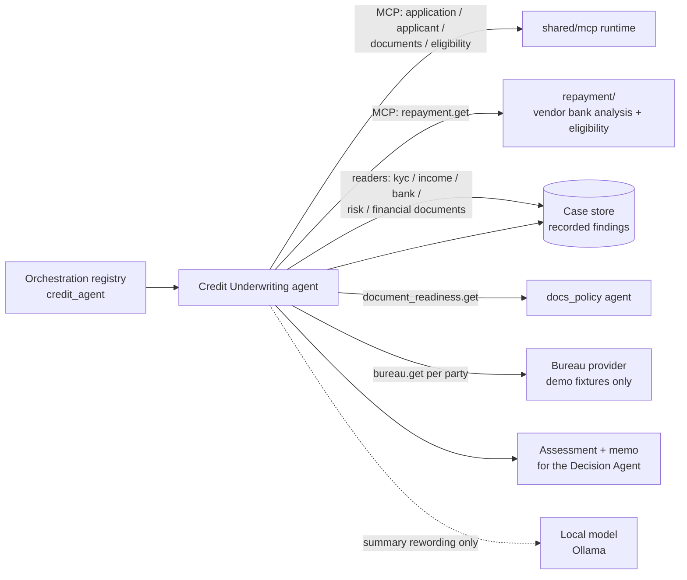
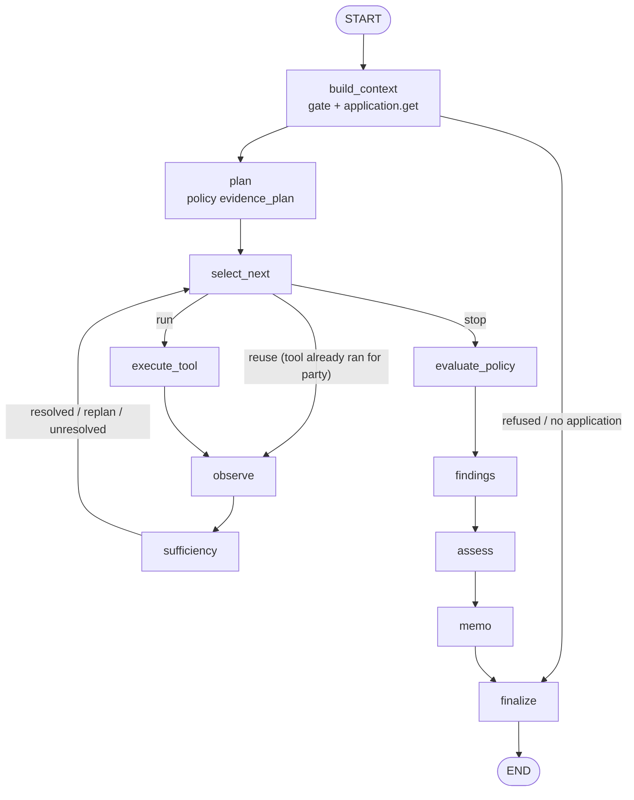

# Credit Underwriting — Design

The parent credit agent. For one case at the CREDIT stage it reads what the agents before it already recorded
(application, documents, KYC, income, bank behaviour, eligibility, risk, repayment, document readiness) and a bureau
report per party. It applies the underwriting policy's rules to those values and writes an evidence-linked
UNDERWRITING ASSESSMENT for the Decision Agent. **No model decides anything.** The plan, the rules and the status are
deterministic and come from the policy file. The local model (Qwen via Ollama) may only reword the memo's summary,
once per run. The agent never approves or rejects, and it does not recompute anything another agent owns.

| | |
|---|---|
| Backend code | `backend/agents/underwriting/` |
| Frontend | none in this bundle |
| API base | none here. `agents/registry.py` has no underwriting entry, so `backend/main.py` does not mount it. The agent is reached through the orchestration registry (`shared/orchestration/registry.py`, `credit_agent`) and in-process callers; the README says the full LOS server serves its routes |
| Database | no schema of its own; one finding plus one event in the shared case store (`shared/store`) |
| Policy source | `shared/config/underwriting_policy.yaml` (`UW_DEMO_V1`, `0.1.0-demo`, `DEMO_UNCONFIRMED`, `signed_off: false`); settings in `shared/config/agents.yaml` → `credit_agent` |

---

## 1. Context



* **Caller**: never taken from a payload. `underwrite()` gets it from the authenticated route. The registry handler
  reads it only from the context variable `agent.CALLER`. With no caller the run is refused (`CALLER_REQUIRED`).
* **Gate, before any tool runs** (`context.authorize`): a caller is present, the caller has the scope
  `required_scope` (`INSUFFICIENT_SCOPE`), `shared.security.access.authorize` allows this case, and the case's
  authoritative stage (`shared.los.stages.resolve`) is in `allowed_stages` (`STAGE_NOT_ALLOWED`).
* **Bureau**: there is one interface (`bureau/base.py`) and one implementation, the demo provider, whose reports are
  all marked `is_demo`. In production it is refused unless `ALLOW_DEMO_BUREAU=true`.

## 2. Layout

```
agents/underwriting/
├── agent.py          entry point on the common harness (shared/runtime): spec, output contract, underwrite(),
│                     registry_handler, public(), register()
├── graph.py          the bounded LangGraph evidence graph (also runs as plain functions if LangGraph is missing)
├── context.py        the security gate and the UnderwritingContext built from the application record
├── planner.py        the deterministic plan: evidence categories → allowed sources; answers() = "is it present?"
├── tools.py          the closed tool allowlist (12 read-only tools), grading into Observations, execute()
├── signals.py        the closed set of signals a rule may read (values selected, two declared-vs-recorded diffs)
├── policy.py         loads/validates the policy file, normalises rules, matches() the operators, sign-off gate
├── findings.py       rule evaluation (FIRED / NOT_MET / UNAVAILABLE / DISABLED) → findings + DATA_GAP findings
├── assessment.py     status, contradictions, credit profile, financial observations, input hash
├── provenance.py     the checked chain TOOL → FACT → OBSERVATION → FINDING → ASSESSMENT
├── memo.py           structured credit memo; optional single Qwen rewording of the summary, validated
├── persistence.py    idempotent write of the assessment to the case store; latest() for the Decision Agent
├── schemas.py        pydantic models and enums (statuses, categories, severities, sources, quality)
├── config.py         settings from agents.yaml `credit_agent`, with environment overrides
├── adapters/         thin readers of recorded findings: case_memory (kyc, income), bank, risk,
│                     financial_documents; repayment (grades the repayment.get answer)
├── bureau/           base.py (provider contract, BureauReport, BureauTimeout / BureauError), demo.py
├── repayment/        "can the applicant repay the proposed EMI?" from the vendor's verified bank analysis:
│                     vendor, obligations, metrics, household, rules (5), insights, crosscheck, sections, story,
│                     report, api_response, ai_summary, service, store, config
└── README.md
```

## 3. Flow



* **Plan** (`planner.build_plan`): same inputs give the same plan. It follows `evidence_plan` in order, adjusted by
  `by_employment` and then `by_product`. Party-scoped categories (bureau) get one step per party. A source that is not
  on the allowlist is dropped and recorded as a forbidden attempt.
* **Stops** (`select_next`): all steps settled, `max_tool_calls` reached (open steps become `SKIPPED_BUDGET`), the
  deadline passed, or the loop guard tripped.
* **Bounds**: each tool runs at most once per party (later needs reuse the observation), at most `max_replans` moves
  to an alternative source, and at most one retry, only for a transient bureau timeout.
* **Sufficiency** only checks whether the evidence is present (`planner.answers`). It never decides whether the
  evidence is good enough.
* Run status: `EVIDENCE_COMPLETE`, `EVIDENCE_INCOMPLETE`, `CONTEXT_UNAVAILABLE` or `REFUSED`. Every step is recorded
  on the harness trajectory.

## 4. Policy and findings

The evidence plan (`underwriting_policy.yaml`):

| Category | Required | Scope | Sources (in order) |
|---|---|---|---|
| application | yes | case | application.get |
| documents | no | case | documents.get |
| kyc | yes | case | kyc.get |
| income | yes | case | income.get, bank_behaviour.get, financial_documents.get (SELF_EMPLOYED: bank first, then ITR, then income.get) |
| banking | no | case | bank_behaviour.get |
| eligibility | yes | case | eligibility.get |
| risk | no | case | risk.get |
| bureau | yes | party | bureau.get |
| repayment | no | case | repayment.get |
| document_policy | no | case | document_readiness.get |

**Rules**: there are 28 demo rules. Each reads exactly one signal from the closed set in `signals.py` and has an
operator (`lt lte gt gte eq ne in not_in between`), a threshold, a severity (`INFO LOW MEDIUM HIGH`), a finding status
(`POSITIVE NEGATIVE REVIEW`) and a `confirmation_status`.

| Signal (scope) | Rules |
|---|---|
| bureau.score, history_months, max_dpd_12m (party) | UW_BUR_SCORE_LOW / _STRONG, UW_BUR_THIN_HISTORY / _ESTABLISHED_HISTORY, UW_REP_DPD_30 / _DPD_MINOR / _CLEAN |
| bureau.settlements, write_offs, enquiries_6m (party) | UW_ADV_SETTLEMENT, UW_ADV_WRITE_OFF, UW_ADV_ENQUIRIES |
| bank.returned_transaction_count, mandate_debit_count | UW_BNK_RETURNS, UW_BNK_MANDATE_DEBITS |
| income.consistency_status | UW_INC_RECORDED_REVIEW / _PASS |
| income.declared_vs_recorded_diff_pct | UW_INC_DECLARED_VS_RECORDED |
| eligibility.status | UW_REC_ELIGIBILITY_NOT_PASS / _PASS |
| repayment.verdict | UW_BANK_REPAYMENT_NOT_RECOMMENDED / _REFER / _RECOMMENDED |
| document_readiness.status | UW_DOCS_ACTION_REQUIRED / _EXCEPTION_PENDING / _COMPLETE |
| risk.final_outcome, kyc.status (party), documents.not_passed_count | UW_REC_RISK_NOT_PASS, UW_REC_KYC_NOT_PASS, UW_REC_DOCUMENT_NOT_PASSED |
| obligations.bureau_vs_declared_diff_pct (primary) | UW_OBL_BUREAU_VS_DECLARED |

* Signal values are selected, not computed. There are two exceptions, both declared-vs-recorded differences:
  |a − b| / max(|a|, |b|) × 100.
* An unavailable signal is a result with a reason. It is never treated as 0, false or clean.
* A **FIRED** rule becomes a Finding with its evidence references. A finding with no evidence raises
  `FindingWithoutEvidence`. **NOT_MET** produces nothing. **UNAVAILABLE** produces a `DATA_GAP` finding: a required
  category that did not resolve gets `required_gap_severity` (HIGH), and any other gap gets `data_gap_severity` (LOW).
* **Assessment status** (`assessment.py`), in order of precedence:
  1. `DATA_INSUFFICIENT`: a required category did not resolve.
  2. `REVIEW_REQUIRED`: a REVIEW or NEGATIVE finding at or above `review_at_severity` (MEDIUM), a contradiction
     between different sources (shown, never averaged), or unverified evidence.
  3. `READY_FOR_DECISION`: otherwise.

  The status names a hand-off, not an outcome.

## 5. Output

* **Assessment** (`CreditAssessment`): `assessment_id` (`CA-` + input hash), status, `status_reasons`,
  `credit_profile` (bureau per party plus the recorded KYC status), `financial_observations` (recorded values only),
  findings, the evidence that was cited, `data_gaps`, `exceptions` (tool unavailable, forbidden tool, stop reason,
  unverified evidence), the policy reference, `is_demo`, `input_hash` and `rule_evaluations`.
* **Memo** (`memo.py`): sections for profile, banking, income, repayment, adverse and exceptions, plus a summary. The
  memo is always built from the assessment without a model. If `llm_enabled` is on and the provider is reachable, one
  model call may reword the summary. The rewording is used only if the shared validator (surface `credit_memo`)
  accepts it: no leaked identifier, no decision words, no number or date missing from the facts, and no other
  assessment status. The memo's `validation` field records `PASSED`, `DISCARDED:<check>`, `LLM_DISABLED`,
  `LLM_UNAVAILABLE` or `LLM_FAILED:<code>`.
* **Output contract** (`agent.spec`): the output must not contain decision words (APPROVED, REJECT, DECLINED,
  SANCTIONED …) or secrets. It must have the keys `assessment`, `memo` and `evidence_status`; the status must be one
  of the three; `next_step` must be `DECISION_AGENT`; and every non-gap finding must cite known evidence. An output
  that fails the contract is never persisted.
* **Provenance** (`provenance.py`): the chain is TOOL → FACT → OBSERVATION → FINDING → ASSESSMENT, with stable node
  ids. Each fact is checked against this case's records (store findings, document ids, the bureau report id). A
  finding that rests on an unverified fact is marked `UNVERIFIED`. The chain is internal and is left out of the
  stored and returned assessment.
* **Repayment sub-module**: `repayment/report.py` turns the 5 rules (data complete, repayment track, true FOIR,
  balance cover, income support → PASS / REFER / DECLINE) into RECOMMENDED / REFER / NOT_RECOMMENDED. The underwriting
  graph reads that verdict through `repayment.get`.

## 6. Data / persistence

* `persistence.record` writes **one** `CaseFinding` (kind `UNDERWRITING`, stage `CREDIT`, source type
  `CREDIT_ASSESSMENT`, `content_hash` = input hash) and one `CREDIT_ASSESSED` case event to the shared case store. The
  docstring says "SQLite today"; `shared/store` holds both `sql_repo.py` and `postgres_repo.py`.
* **Idempotent**: the same case facts under the same policy version give the same hash. The stored payload is then
  returned as a replay, with no second row and no second event. `latest(case_id)` is the Decision Agent's read.
* What is stored: the assessment (without provenance), the memo, `run_id` and `agent_version`. The caller identity,
  credentials, raw documents and prompts are not stored.
* The repayment vendor analyses are kept by `repayment/store.py` (`settings.yaml store`). The `files` backend writes
  to `runtime/credit_bank_analysis` and falls back to `samples/credit_bank_reports`. The `postgres` backend uses the
  table `credit_bank_analysis`. Only the normalised blocks are stored, never the raw upload.

## 7. API

This service has no routes for it, because `registry.py` has no entry and `main.py` mounts only that list. Ways in:
`shared/orchestration/registry.py` registers `credit_agent` → `agent.registry_handler`, and
`shared/config/copilot_actions.yaml` names `agents.underwriting.agent.underwrite`. The README lists
`POST /api/v1/credit/underwriting/run` and `GET /api/v1/credit/{case_id}` as served by the full LOS server (8010).
`repayment/api_response.py` describes `POST /api/v1/credit/assess/{case_id}`, which is also not mounted in this
bundle.

## 8. Frontend

None in this bundle.

## 9. Configuration

* `shared/config/agents.yaml` → `credit_agent`: `enabled`, `version`, `llm_enabled`, `max_iterations` 10,
  `max_tool_calls` 12, `timeout` 25, `deadline_seconds` 20, `required_scope` `los.credit.underwrite`,
  `allowed_stages` [CREDIT], `max_replans` 2, `bureau_provider` demo, `bureau_timeout_seconds` 3.0,
  `bureau_retries` 1 (capped at 1), `policy_file`, `memo_timeout_seconds` 2.5.
* Environment overrides: `CREDIT_AGENT_ENABLED`, `CREDIT_REQUIRED_SCOPE`, `CREDIT_ALLOWED_STAGES`,
  `CREDIT_BUREAU_PROVIDER`, `CREDIT_MEMO_LLM_ENABLED`, `UNDERWRITING_POLICY_PATH`, `CREDIT_DEMO_BUREAU_PATH`,
  `ENVIRONMENT`, `ALLOW_UNSIGNED_UNDERWRITING_POLICY`, `ALLOW_DEMO_BUREAU`.
* In production an unsigned policy is refused unless `ALLOW_UNSIGNED_UNDERWRITING_POLICY=true` is set
  deliberately. Changing the policy means editing the YAML; no code change is needed.
* Demo bureau fixtures: `shared/config/demo/bureau_demo.yaml`.
* Repayment: `shared/config/credit_underwriting/` (`vendor_fields`, `policy` — signed off 2026-10-19, 6-month
  window — `settings`, `wording`).

## 10. Tests

There is no `tests/` folder under `agents/underwriting/` in this bundle, although the README mentions one. Tests that
reach the agent from elsewhere:
`agents/docs_policy/tests/test_docs_verify_credit_agent.py` (`test_credit_agent_run_reads_document_readiness_and_finds_on_it`;
it also patches `repayment.ai_summary._ask`) and `agents/dedupe/tests/test_customer_history.py` (uses
`underwriting.config`).
