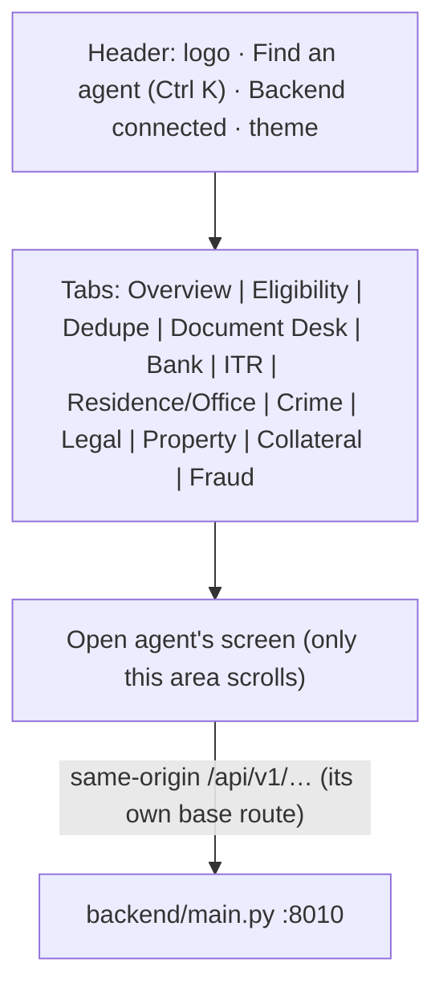

# Frontend — Common Design

**One** React + Vite app, the *Credit Underwriting console*, holds every agent's screen. A header carries the brand,
quick search, backend status and theme; under it **one tab per agent** runs across the top (like the LOS
verification screen). Every agent looks like **Legal Verification** (the reference screen): same background, type,
colours, card style, loader — and every result follows **one layout**: *Basic card → AI summary → Rules | Calculations
→ Actions*. Shared pieces live in `src/shared/`; each agent's screen lives in `src/agents/<agent>/` and uses them.
**No static HTML**: `index.html` is only the Vite entry; the backend serves JSON only.

| | |
|---|---|
| App | `frontend/` — Vite 5 + React 18 (TypeScript; two screens still JS), one `package.json` |
| Entry | `index.html` → `src/main.jsx` → `src/App.tsx` (header + tabs + open agent) |
| Agents | `src/config/agents.ts` (tab order, labels, icons, **API base routes**) + `src/agents/registry.ts` (lazy screens) |
| Design tokens | `src/shared/styles/tokens.css` (Ink & Ember, `docs/DESIGN.md`) |
| Common agent look | `src/shared/styles/agent-theme.css` (Legal's background, type, radii, focus — for every agent) |
| Common result | `src/shared/components/result` + `src/shared/styles/result.css`; live example at **`/design`** |
| Backend | one FastAPI service `backend/main.py` on **8010**; each agent keeps its own `/api/v1/...` base route |

---

## 1. Visual design (Legal Verification's look, for every agent)

### 1.1 Type

| Use | Font | Size / line | Weight |
|---|---|---|---|
| Body, inputs, buttons | **Lexend** (fallback Inter, Segoe UI) | 15px / 22px, letter-spacing −0.006em | 400 / 500 / 600 |
| Headings, numbers, card titles | **Space Grotesk** | page title 26/32, card title 16/22, KPI 24/28 | 700 |
| Small labels (eyebrows, fact labels) | Lexend, UPPERCASE, +0.05–0.08em | 10.5–11.5px | 600–700 |
| Table header | Lexend, sentence case | 13px | 600 |
| Table cell | Lexend | 14px | 400 |
| IDs, PAN, account, codes | `ui-monospace, Cascadia Code, Consolas` | 13.5px | 500 |

### 1.2 Colour (Ink & Ember v3.0 — slate; code names `--ie-*`, `src/shared/styles/tokens.css`)

| Role | Token | Light | Use |
|---|---|---|---|
| Page background | `--ie-canvas` | `#F4F6FA` | every agent screen (no gradients / glows) |
| Surface | `--ie-surface` | `#FFFFFF` | cards, tables, inputs |
| Raised | `--ie-raised` | `#F1F5F9` | hover, chips, icon tiles |
| Border / divider | `--ie-border` | `#E2E8F0` | 1px card / table borders (borders before shadows) |
| Text | `--ie-text-primary` / `--ie-text-secondary` | `#0F172A` / `#64748B` | |
| **Action — creates** (navy, owner 2026-11-11: no black buttons) | `--cu-action` | `#172554` (hover `#1E3A8A`) | primary buttons, selected filter chip, number badges (one primary button per view) |
| Band | `--ie-band` → `--ie-band-end` | `#0F172A` → `#21245E` | the basic card, page heroes |
| **Mark — dark blue** (replaces ember, owner 2026-11-11) | `--ie-ember` | `#1E40AF` (hover `#1E3A8A`, ground `#DBEAFE`, wash `#EFF6FF`) | active tab underline, focus ring, "needs you" — never decoration |
| **Indigo — informs** | `--ie-link` | `#4F5AC7` | links, info chips, "AI summary" source tag |
| Pass | `--ie-success` | `#15803D` (word `#166534`) on `#E3F0E8` | |
| Review | `--ie-warning` | `#B45309` (word `#92400E`) on `#F5E7DD` | |
| Fail | `--ie-error` | `#DC2626` (word `#B91C1C`) on `#FBE7E7` | |

Each agent maps its **own recommendation words** to these tones (its `src/agents/<agent>/DESIGN.md` §3 lists them);
background, type, neutrals and the tone colours are common. No orange anywhere: the mark is dark blue `#1E40AF` for every agent (the token keeps its name `--ie-ember`). Dark theme: tokens switch (`docs/DESIGN.md` §15.1); each agent keeps its own dark palette.

### 1.3 Shape and spacing

Radii **6 / 8 / 12 / 16 / 20px** (chips 6, inputs and buttons 8, list boxes 12, cards 16, the basic card 20).
Spacing scale 4 · 8 · 12 · 16 · 20 · 24. Gaps between result cards 16px (12px on mobile). Buttons and inputs 40px tall.
Shadows only on the basic card and popovers; everything else is a 1px border.

### 1.4 Logo and loader

* **Logo** (`shared/components/Logo.tsx`): an ink tile with a document and a blue check — "credit file, verified".
* **Agent icons** (`shared/components/Icon.tsx`): one line icon per agent (tabs, overview cards, loader emblem).
* **Loader** (`shared/components/Loader.tsx`, after Legal's): an ink→dark-blue arc turning, a thin counter arc, sparks,
  the open agent's emblem in the middle with a scan line, and what is happening, one line at a time, with step dots.

## 2. The console



* **Tabs**: Overview first, then the agents in journey order with a thin divider between stages (Application,
  Verification, Property, Risk). The row scrolls sideways with ‹ › when it does not fit; the open tab is underlined in
  dark blue and always scrolled into view. The URL path is the open agent (`/eligibility`); back/forward work.
* **Overview**: the journey as a board — four stage columns, each agent a card (icon tile, name, one line).
* **Ctrl K**: quick switcher — type a few letters, Enter opens the agent.
* **Backend status**: `GET /health` every 30 s — green "Backend connected" / red "Backend offline".
* **Isolation**: an agent's stylesheets are scoped to it (`scripts/scope-agent-css.js`, class `agent-<id>` on
  `<html>` while open), so no agent's CSS touches another agent or the shell. The shell uses no bare
  `header/nav/main/section/h1` elements, so agents' element rules can never restyle it.

## 3. THE COMMON RESULT LAYOUT (every agent)

```
┌──────────────────────────────────────────────────────────────────────────┐
│ 1. BASIC CARD (dark ink)  [eyebrow]  Title (applicant)        [DECISION] │
│    facts: Case ID · Application · Amount · Date …                        │
│    [ KPI ] [ KPI ] [ KPI ] [ KPI ]   (rules run · passed · review · fail) │
├──────────────────────────────────────────────────────────────────────────┤
│ 2. AI SUMMARY  ① point  ② point  ③ point …            [AI / Rules summary]│
├──────────────────────────────────────────┬───────────────────────────────┤
│ 3a. RULES  [All 12][Fail 2][Review 2]…   │ 3b. CALCULATIONS              │
│  ● Rule name — detail     R01 [✓ Pass] ⌄ │  INCOME                       │
│  ● …  (8 per page, open a row for values)│  Declared …        ₹ 1,20,000 │
│  1–8 of 12 rules            ‹ 1 2 ›      │  RATIOS  FOIR 56.4%  LTV 82%  │
├──────────────────────────────────────────┴───────────────────────────────┤
│ 4. ACTIONS (sticky)        Download report · Hold · Decline · Submit     │
└──────────────────────────────────────────────────────────────────────────┘
```

* Component: `ResultPage` (`shared/components/result`) with `BasicCard`, `AiSummary`, `RulesPanel`, `CalcPanel`,
  `ActionBar`; data types in `result/types.ts`. Each agent maps its API answer with a pure adapter
  `src/agents/<agent>/utils/resultView.ts → toResultPage(result): ResultPageProps` (unit-tested).
* **Rules** never grow the page: filter chips (All / Fail / Review / Pass with counts), **8 per page**, a row opens to
  show the compared values. Status always has a word and an icon, never colour alone.
* **Calculations**: label · value (· hint), grouped (Income, Obligations, Ratios …), paged after 10.
* **Actions**: navy primary (`--cu-action` #172554), red Decline, dark-blue Hold, ghost Download. An action with no handler yet shows
  "“Hold” is not connected yet." — real handlers (legal decision, crime finalize …) are wired where they exist.
* Agent-specific extras (statement viewer, audit timeline, per-person checklists) sit under the layout, paginated.

## 4. Responsive: laptop, tablet, mobile

| Width | Layout |
|---|---|
| Laptop ≥ 1100px | Rules and Calculations side by side (1.45 : 1); summary points in columns; content max 1320px, centred |
| Tablet 641–1099px | one column (Rules, then Calculations); KPI tiles wrap; overview board 2 columns |
| Mobile ≤ 640px | one column, 12px gutters; facts and KPI tiles 2 × 2; rule meta under the name; action buttons 2 × 2; header shows icons only; tabs scroll sideways |

Every screen is checked at **1440 × 900, ~900 wide and ~520 wide** (headless Edge clamps narrower) before release.
No fixed pixel widths in agent CSS; wide tables sit in an `overflow-x: auto` wrapper; the page itself never scrolls
sideways.

## 5. Pagination first

Every list or table that can grow uses `usePagination` + `<Pagination>` (`shared/components`): 10 per page (20 / 50
selectable; rules 8), hidden when everything fits, back to page 1 on a new search. Rule-config edits on page 2+
change the right row (absolute index or key).

## 6. The agents

| Stage | Agent (`src/agents/…`) | Path | API base route (unchanged) | Proxy override |
|---|---|---|---|---|
| Application | `eligibility` | `/eligibility` | `/api/v1/eligibility` | `ELG_API` |
| Application | `dedupe` | `/dedupe` | `/api/v1/credit/dedupe` | `DDP_API` |
| Application | `docs_policy` (Document Desk) | `/docs_policy` | `/api/v1/credit/document-readiness` | `DCP_API` |
| Verification | `bank_verification` | `/bank_verification` | `/api/v1/bank-verification` | `BV_API` |
| Verification | `itr_verification` | `/itr_verification` | `/api/v1/credit/itr-verification` | `ITR_API` |
| Verification | `residence_office_verification` | `/residence_office_verification` | `/api/v1/credit/residence-office-verification` | `ROV_API` |
| Verification | `crime_verification` | `/crime_verification` | `/api/v1/credit/crime-verification` | `CRV_API` |
| Property | `legal_verification` | `/legal_verification` | `/api/v1/credit/legal-verification` | `LGV_API` |
| Property | `property_valuation` | `/property_valuation` | `/api/v1/credit/property-valuation` | `PRV_API` |
| Property | `collateral_verification` | `/collateral_verification` | `/api/v1/credit/collateral-verification` | `COL_API` |
| Risk | `fraud_screening` | `/fraud_screening` | `/api/v1/credit/fraud-screening` | `FRS_API` |

Adding an agent = one entry in `src/config/agents.ts` + one line in `src/agents/registry.ts` + its folder (with
`index.tsx`, a `utils/resultView.ts` adapter, and its result rendered through `ResultPage`).

## 7. Folder shape

```
frontend/
├── index.html · package.json · vite.config.ts (port 5190, per-agent /api proxy) · vitest.workspace.ts
├── postcss.config.js (tailwind for ITR + scope-agent-css) · tailwind.config.js · scripts/scope-agent-css.js
├── public/dedupe/            dedupe's page texts and sample pools
└── src/
    ├── main.jsx · App.tsx    shell: TopNav + AgentHost / Home; /design = the result layout with example data
    ├── config/agents.ts      the agents (data only)
    ├── shared/
    │   ├── components/       TopNav, Logo, Icon, Home, AgentHost, Loader, ErrorBoundary, CommandPalette, Pagination,
    │   │                     DesignPage, result/ (ResultPage, BasicCard, AiSummary, RulesPanel, CalcPanel, ActionBar)
    │   ├── hooks/            usePagination, useBackendStatus
    │   ├── styles/           tokens.css · shell.css · agent-theme.css · result.css
    │   └── theme.ts          light / dark / system for the whole console
    ├── agents/<agent>/       index.tsx · App · components · pages · services (the only fetch) · utils/resultView.ts · test
    └── test/                 shell, pagination and result-layout tests
```

Rules: components never call `fetch`; an agent never imports another agent; shared code never imports an agent
(except `registry.ts`); no business rule in the UI — labels, options, thresholds come from the API.

## 8. States every screen handles

Loading (the loader, or skeleton lines in the summary) · Empty (one sentence and the action that fills it) · Error (the
API's `error.message`, the form keeps its values) · Not found (same text whether missing or out of branch) ·
Forbidden ("You don't have permission for this action") · Crash (ErrorBoundary card; other agents unaffected).
Accessibility: visible labels, dark-blue focus ring, keyboard reachable, status never by colour alone, text contrast ≥ 4.5:1.

## 9. Run, build, test

```powershell
uvicorn main:app --host 0.0.0.0 --port 8010     # backend\ first
cd frontend
npm install
npm run dev          # http://localhost:5190   (/design shows the common result layout)
npm run build        # type-check + bundle -> dist\ (one chunk per agent)
npm test             # every agent's tests + shell + result layout
```

Production: serve `dist/` behind the same origin as the API; route `/api/*` and `/health` to the backend and every
other path to `index.html` (the tabs are client-side paths).

## 10. Known differences

* `itr_verification` styles with Tailwind (scoped), keeps a user-editable API base in Settings.
* `collateral_verification` and `residence_office_verification` are JavaScript (no TypeScript).
* `legal_verification` uses Mantine themed to Ink & Ember (`theme.ts`).
* `dedupe`'s "New application" and sign-in need `/api/v1/fos/*` and `/api/v1/auth/*` from the full LOS.
* **Dedupe "New application"** needs the FULL LOS server's `/api/v1/fos/*` (and `/api/v1/auth/*`): set `FOS_API` (see
  `.env.example`, e.g. `http://127.0.0.1:8010`) when the agents run on a separate service. In development the dedupe
  sources (miFin, LMS, RCU, collateral) answer on demo data with `MIFIN_PROVIDER=demo LMS_PROVIDER=demo RCU_PROVIDER=demo
  COLLATERAL_PROVIDER=demo` in `backend/.env`; without them the check honestly says "Check incomplete".

## Common result layout v2 (owner 2026-11-11)

1. **Compact header** (~170px): emblem, title, decision; 4 facts; the counters **Rules · Passed · Review · Failed**
   (counted from the rules — the same on every agent).
2. **AI summary**: 3 points then "Show all", beside **✓ Strengths** (passed rules) | **✕ Concerns** (failed / review),
   4 each then "+n more".
3. **Calculations (left) | Rules (right)**: the rules are a **grid of cards** (2 columns, failed first, coloured edge,
   "Show values"), **6 per page**; calculations 10 per page. An agent's own counters go to Calculations → *Key figures*,
   facts past the header's four → *Case details*; plain duplicates of the rule counts are dropped.
4. **Actions**: sticky on laptop / tablet; at the end of the result on phones.

Section names are fixed in the shared component: **AI summary · Strengths · Concerns · Calculations · Rules**.

## Result layout v3 (owner 2026-11-11)

- **AI summary**: a score ring (passed / review / failed of the rules), the first point as the bold **headline**, the
  rest as an insight grid (3 then "Show all"); **Concerns** as small red / amber cards beside **Strengths** as green chips.
- **Calculations**: "Key figures" as bold tiles; other groups as label · **bold value** rows with a coloured dot for
  pass / review / fail; group names in small blue caps.
- **Bank**: the flow is tabs: Bank details | Verification | Agency | Report, one screen at a time. With AA data
  received, "AA not received" is disabled.

## One structure on every agent (owner 2026-11-11)

Header → AI summary → Calculations (left) | Rules (right) → **More details** → actions, on every agent.

- **Decision words** (`src/config/result.ts`): Positive · Refer · Negative · Pending by tone; the agent's own word small under it.
- **AI point → rule**: a point that names a rule (its id, or most of its name) gets an `R05 ›` link; it, and every
  Strength / Concern, opens that rule on its page and lights it.
- **Case strip**: once the header scrolls away, a thin navy strip keeps name, case ID, counts and decision on top.
- **More details**: an agent's own sections (AML / PEP, people, comparison, evidence …) sit in one card, closed by
  default with the section names shown; open from the start where it holds the decision remarks (Legal Final Status).
- **Result into view**: when a form sits above the result, the page scrolls to the result once it arrives.
- **No development names**: a dev log-in (`HIDDEN_PEOPLE` in `src/config/result.ts`) shows as "Officer"; real names show.

## Result v5: one section at a time, form then result (owner 2026-11-11)

- **Midnight Sapphire** (the standalone Legal UI's shades): header band `#1E1B4B → #312E81 → #3B57D6`, accent `#3B57D6`,
  action `#253DA3`; summary points on `#F5F8FF` with a sapphire edge; rule cards lightly tinted by result.
- **Section rail** under the header: **Overview · Rules (n, red count of failed) · Calculations (n) · More details**, one
  shown at a time (all stay mounted); ← → keys move along the rail. Overview = AI summary (points numbered 1, 2, 3 …),
  Strengths | Concerns, and a card per other section. Rules: 3 cards a row on a wide screen; Calculations: 2 columns.
- **Form, then result** (Eligibility, Fraud, Residence, ITR, Collateral): after the run the form is put away and the result
  opens alone under a "← Back to the form" bar (`useResultScreen`, `FormArea`, `BackToForm`); what was typed is kept.

## v6: what each tab shows (owner 2026-11-12)

- **No jumping header**: the separate case strip is gone. The section rail sticks to the top; once stuck it shows the
  case name and decision inside it (same height, so nothing below moves).
- **Overview** shows only the summary: the numbered points; the **Next step** (a point starting "Next step / Next action /
  Proceed with …", `NEXT_STEP_STARTS`) as its own navy line; **Key numbers** (up to 4 values from the result: amounts
  and percentages first, then checked values, never a bare 0); Strengths | Concerns. The other sections are in their tabs
  only, nothing repeated.
- **Rule cards**: a rule with a comparison pair (`COMPARE_PAIRS`: Value | Limit, Application | Vendor report …) shows it
  on the card as two boxes, worded `COMPARE_WORDS` (Value → **Actual**, Limit → **Policy limit**, right for a floor or a
  ceiling); numbers in Indian grouping; the detail line is dropped when it only repeats the pair. The rest of the values
  open with "Show values".
- Agent button styles never reach the shared buttons (chips, links, tabs keep their own size).

## v6b (owner 2026-11-12)

- **Full width after a form**: any container around a result drops its own width cap (`agent-theme.css`); the result
  goes up to 1560px with a 24px gutter. Agents with a side menu keep the menu; the result fills the rest.
- **No internal ids on a result**: run ids (`er_…`), "Result #", "Saved result #", "Verification #" and the database
  application id are not shown; the case / application number the officer knows stays.
- **Plain words in summary points**: field names (`acknowledgement_number`) read as words; `UPPER_WORDS` (PAN, GTI,
  EMI, FOIR …) in capitals.
- **Pager**: shows whenever there is more than one page (a list of 7–10 rules at 6 a page was cut before).
- **Key numbers**: must hold a digit, each label once, no bare 0, no same number under a near-same label.

## Agent titles (owner 2026-11-12)

- Every agent's header shows **its logo** (its icon from `src/config/agents.ts`, on a sapphire tile) with **its full
  name typing beside it**: types, pauses, erases, types again (Legal's brand title, now `AgentTitle` / `Typewriter` in
  `shared/components`; speeds `TYPEWRITER` in `src/config/result.ts`). The full width is reserved so nothing beside it
  moves; reduced motion shows it still; the full name is always the accessible name.
- Names come from one list (`title` in `src/config/agents.ts`): Eligibility Check · Dedupe · Credit Document Desk · Bank
  Verification · ITR Verification · Residence / Office Verification · Crime Record Verification · Legal Verification ·
  Property Valuation · Collateral Verification · Fraud Screening.
- One size: 22px in a main header, 16px in a side menu, 18px on a phone; agent stylesheets cannot change it.
- Headers in plain words: no "database", "API: Connected", "API Settings" (dev builds only), "no upload needed".

## Rules & Calculations in one tab (owner 2026-11-12)

- Tabs: **Overview · Rules & Calculations · More details**. In the second: **Calculations 30% (left) | Rules 70% (right)**,
  both as tall as the taller one (no white space), each with its own pager.
- Rules **one per row**: id · severity · status on top; the name and detail on the left, Actual | Policy limit beside
  them on a wide screen (below on a phone); 6 a page.
- Bank uses the screen: page up to 1600px, Agency / Report full width, the Agency choices side by side.

## One frame on every agent (owner 2026-11-12)

- Every agent has the same **left sidebar** when it opens (`AgentFrame`, `shared/components`): logo + name typing,
  what the agent does, the case open now, and its sections as a vertical menu (Verify / Rule config / History …; form
  agents also get "Result" once a run is back). Docs, Crime, Legal and Dedupe keep their own sidebars of the same shape.
  On a phone the sidebar is a compact block on top with the menu as one row.
- Bank: the case search sits in the sidebar; a finished run (Run verification / Retrigger) always opens Verification,
  at the top of the page; primary buttons in the console's sapphire.
- Phone: Calculations and Rules stack (the 30 | 70 split is for laptop / desktop only); tabs keep their full names for
  screen readers even when only the icon shows.
